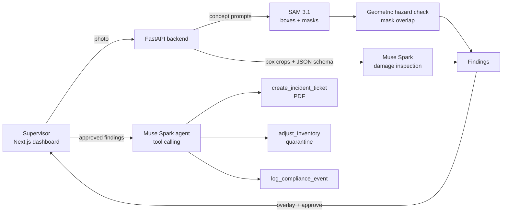

# AIsleEye

**Warehouse floor copilot: one photo in, damage and hazard tickets out.**

AIsleEye turns a single phone photo of a warehouse aisle or pallet into actionable operations data. It segments every box and floor marking, inspects each box for physical damage, detects pedestrian walkways blocked by freight, and — once a supervisor approves — an agent automatically files incident tickets, quarantines damaged inventory and logs compliance events.

It is built entirely on Meta's latest models via the [Meta Model API](https://dev.meta.ai/docs/overview):

| Capability | Model |
|---|---|
| Text-prompted segmentation (boxes + pixel masks) | `sam-3.1` |
| Visual damage inspection with schema-constrained JSON | `muse-spark-1.3` |
| Agentic tool calling (tickets, inventory, compliance) | `muse-spark-1.3` (optionally `muse-wonder-1.0`) |

---

## Table of contents

- [Why](#why)
- [How it works](#how-it-works)
- [Architecture](#architecture)
- [Tech stack](#tech-stack)
- [Project structure](#project-structure)
- [Getting started](#getting-started)
- [API](#api)
- [Branching and versioning](#branching-and-versioning)
- [Roadmap](#roadmap)
- [Security and privacy](#security-and-privacy)
- [Datasets](#datasets)

---

## Why

Small and mid-sized warehouses still rely on manual floor walks and clipboards:

- **Damaged freight is found late** — usually at dispatch or by the customer.
- **Blocked walkways are a top safety risk**, but audits are periodic and paper-based.
- **Inventory and safety live in separate systems**, so one walk produces two sets of manual paperwork.

AIsleEye collapses that into one scan with a human in the loop.

## How it works

1. **Scan** — a supervisor uploads a photo of an aisle or pallet.
2. **Segment** — SAM 3.1 is prompted with concepts such as `cardboard box` and `floor tape`, returning a box and a pixel mask for every instance.
3. **Inspect** — each box crop is sent to Muse Spark with a strict JSON schema (`damaged`, `damage_type`, `severity`, `confidence`, `reason`).
4. **Detect hazards** — walkway blockage is computed **geometrically** (box mask ∩ walkway mask), not guessed by a model, so it is deterministic and explainable.
5. **Review** — findings are shown on the image overlay with severity and confidence. The supervisor approves the ones to act on.
6. **Dispatch** — a Muse Spark agent calls tools to create a PDF incident ticket, move damaged units to quarantine and append a compliance log entry. Every tool argument is validated before execution.

## Architecture



## Tech stack

| Layer | Choice |
|---|---|
| Frontend | Next.js 16 (App Router), React 19, TypeScript, Tailwind CSS 4 |
| Backend | Python 3.13, FastAPI, Pydantic v2, OpenAI SDK (pointed at Meta Model API) |
| Segmentation parsing | [`meta-sam-parser`](https://dev.meta.ai/docs/sam/client-libraries) |
| Imaging / reports | Pillow, NumPy, ReportLab |
| Storage (MVP) | JSON files on disk — no database required |
| CI/CD | GitHub Actions: branch-name check + automatic semantic releases |

## Project structure

```
.
├── backend/
│   ├── app/
│   │   ├── main.py          # FastAPI app, CORS, /health
│   │   ├── config.py        # Settings loaded from the root .env
│   │   └── clients.py       # Meta Model API client + image helpers
│   ├── scripts/
│   │   └── smoke_test.py    # Verifies every model capability end to end
│   └── requirements.txt
├── frontend/
│   └── src/
│       ├── app/             # Dashboard page, layout, dark industrial theme
│       ├── components/      # UI components (e.g. backend status)
│       └── lib/api.ts       # Typed API client
└── .github/
    ├── scripts/next_version.sh
    └── workflows/           # branch-name.yml, release.yml
```

## Getting started

### Prerequisites

- Python 3.10+ (3.13 recommended)
- Node.js 20.17+ and npm
- A Meta Model API key from the [developer dashboard](https://dev.meta.ai/)

### 1. Configure environment

Create a `.env` file in the repository root (it is git-ignored):

```dotenv
MODEL_API_KEY=your_key_here
MODEL_API_BASE_URL=https://api.meta.ai/v1
MUSE_MODEL=muse-spark-1.3
SAM_MODEL=sam-3.1
MUSE_AGENT_MODEL=muse-wonder-1.0
REQUEST_TIMEOUT_S=90
CORS_ORIGINS=["http://localhost:3000"]
```

Only `MODEL_API_KEY` is required; the rest have sensible defaults.

### 2. Backend

```bash
cd backend
python3 -m venv .venv
.venv/bin/pip install -r requirements.txt

# Verify text, vision, structured output, tool calling and SAM 3.1
.venv/bin/python -m scripts.smoke_test --image path/to/warehouse.jpg

# Run the API
.venv/bin/uvicorn app.main:app --reload --port 8000
```

The smoke test prints `PASS`/`FAIL` per capability and saves raw outputs to `backend/data/smoke/`. Without `--image` it renders a synthetic scene.

### 3. Frontend

```bash
cd frontend
echo "NEXT_PUBLIC_API_URL=http://localhost:8000" > .env.local
npm install
npm run dev
```

Open <http://localhost:3000>. The status indicator in the header turns green when the backend is reachable.

## API

| Method | Path | Status | Purpose |
|---|---|---|---|
| GET | `/health` | ✅ available | Liveness and configured models |
| POST | `/scan` | 🚧 planned | Image → segmented boxes, walkway mask and findings |
| POST | `/scan/{scan_id}/approve` | 🚧 planned | Run the agent on approved findings |
| GET | `/inventory` | 🚧 planned | Current inventory, including quarantine |
| GET | `/tickets` | 🚧 planned | Incident tickets |
| GET | `/tickets/{id}.pdf` | 🚧 planned | Ticket PDF |
| GET | `/compliance` | 🚧 planned | Compliance log |

**Finding schema**

```json
{
  "id": "f_01",
  "type": "box_damage | walkway_blocked",
  "severity": "low | medium | high",
  "confidence": 0.0,
  "bbox": { "x1": 0, "y1": 0, "x2": 0, "y2": 0 },
  "description": "string",
  "sku": "optional string"
}
```

## Branching and versioning

Releases follow [Semantic Versioning](https://semver.org/) and are **fully automated**. A version is published only when a pull request is **merged into `master`**; the bump is derived from the source branch prefix.

| Branch prefix | Bump | Example from `v1.4.2` |
|---|---|---|
| `major/*`, `breaking/*` | major | `v2.0.0` |
| `release/*`, `feature/*`, `feat/*` | minor | `v1.5.0` |
| `fix/*`, `bug/*`, `bugfix/*`, `hotfix/*` | patch | `v1.4.3` |
| `chore/*`, `docs/*`, `ci/*`, `refactor/*`, `test/*` | none | `v1.4.2` |

- Branch names must match `<type>/<short-name>` (lowercase, `a-z0-9._-`); the **Branch name check** workflow enforces this on every PR to `master`.
- The **Release** workflow reads the latest `vX.Y.Z` tag, computes the next version with [`.github/scripts/next_version.sh`](.github/scripts/next_version.sh), tags the merge commit and publishes a GitHub Release with generated notes.
- Git tags are the single source of truth for the version. The project starts at **`v0.0.1`**.

Example:

```bash
git switch -c fix/sam-mask-offset
# ...commit...
git push -u origin fix/sam-mask-offset
gh pr create --base master --fill
# merge the PR → v0.0.2 is released automatically
```

> Protect `master` so changes land only through pull requests; direct pushes do not produce releases.

## Roadmap

- [x] **Phase 0** — Project scaffold, Meta Model API client, capability smoke test, dashboard shell, CI release pipeline
- [ ] **Phase 1** — Vision pipeline: SAM 3.1 segmentation, box crops, damage inspection, geometric hazard detection, `/scan`
- [ ] **Phase 2** — Agent and tools: ticket PDFs, inventory quarantine, compliance log, `/approve`
- [ ] **Phase 3** — Frontend: upload, mask overlays, findings review, agent action timeline, live KPIs
- [ ] **Phase 4** — Demo assets and offline replay mode
- [ ] **Phase 5** — Hardening: input validation, retries, prompt-injection guards, accuracy evaluation
- [ ] **Later** — Video scans, on-device inference with Muse Glimmer, PPE and spill detection

## Security and privacy

- API keys live only in the git-ignored root `.env`; nothing secret is committed.
- **Human in the loop**: the agent never acts on findings until a supervisor approves them.
- Model output is treated as untrusted: structured outputs are schema-constrained and every tool argument is validated before execution.
- Text visible inside images (labels, signage) is never treated as instructions.
- Uploads will be size- and type-limited and stripped of EXIF metadata.

## Datasets

For evaluation and demos (no training is required — all models are used zero-shot):

| Dataset | Use | License |
|---|---|---|
| [LOCO — Logistics Objects in Context](https://github.com/tum-fml/loco) | Real warehouse scenes | CC0 |
| [SCD — Stacked Carton Dataset](https://github.com/yancie-yjr/scd.github.io) | Carton segmentation and counting | CC BY-NC-SA 4.0 |
| [Industrial Quality Control of Packages](https://www.kaggle.com/datasets/christianvorhemus/industrial-quality-control-of-packages) | Damaged vs intact packages (synthetic) | GPL-2.0 |
| Self-captured walkway photos | Blocked-walkway scenarios | Own |

Non-commercial datasets are used for evaluation only.
