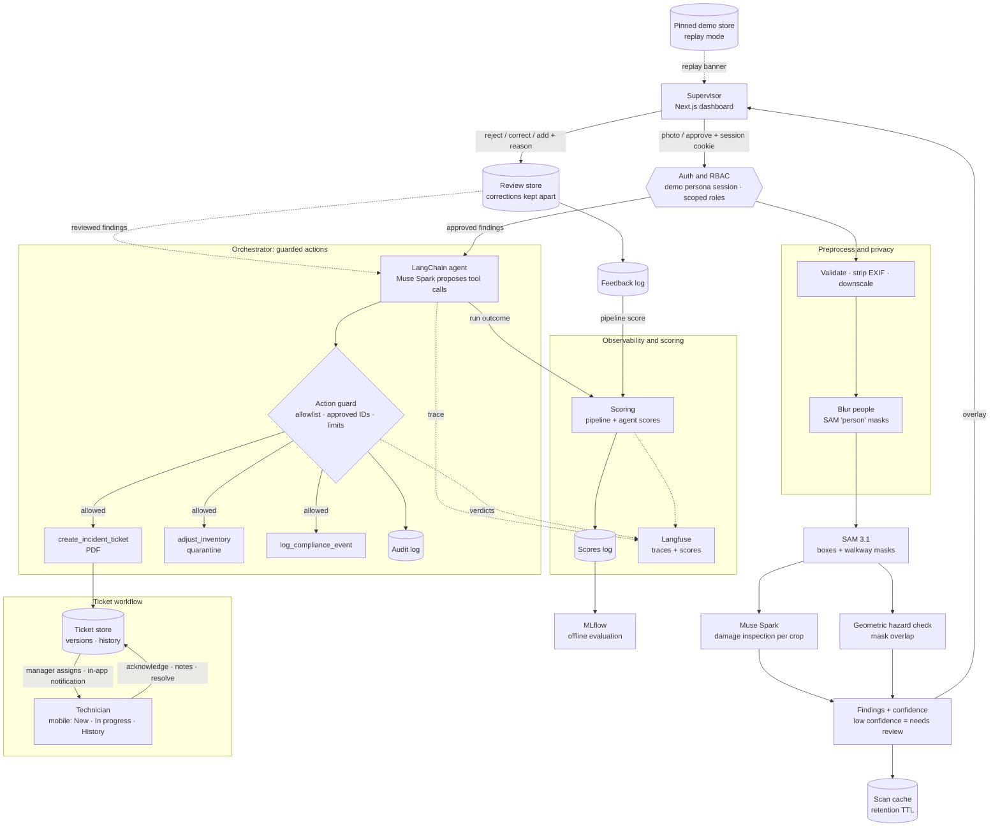

# AIsleEye

**Warehouse floor copilot: one photo in, damage and hazard tickets out.**

AIsleEye turns a single phone photo of a warehouse aisle or pallet into actionable operations data. It segments every box and floor marking, inspects each box for physical damage, detects pedestrian walkways blocked by freight, and lets a supervisor correct anything the model got wrong. Once the supervisor approves, an agent files incident tickets, quarantines damaged inventory and logs compliance events. A manager then assigns each ticket to a named technician, who is notified in the app, acknowledges the job on their phone and resolves it with notes. A stock board and a photo-based shelf count keep inventory in view.

It is built entirely on Meta's latest models via the [Meta Model API](https://dev.meta.ai/docs/overview):

| Capability | Model |
|---|---|
| Text-prompted segmentation (boxes + pixel masks) | `sam-3.1` |
| Visual damage inspection with schema-constrained JSON | `muse-spark-1.3` |
| Agentic tool calling (tickets, inventory, compliance) | `muse-spark-1.3` through a LangChain agent (optionally `muse-wonder-1.0`) |

Agent runs are traced with Langfuse and scored from automatic checks and reviewer feedback, and offline evaluations are tracked with MLflow.

---

## Table of contents

- [Why](#why)
- [How it works](#how-it-works)
- [Architecture](#architecture)
- [Tech stack](#tech-stack)
- [Project structure](#project-structure)
- [Getting started](#getting-started)
- [Configuration](#configuration)
- [Testing](#testing)
- [API](#api)
- [Authentication and RBAC](#authentication-and-rbac)
- [Branching and versioning](#branching-and-versioning)
- [Roadmap](#roadmap)
- [Guardrails, privacy and data handling](#guardrails-privacy-and-data-handling)
- [Reliability and interface](#reliability-and-interface)
- [Datasets](#datasets)

---

## Why

Small and mid-sized warehouses still rely on manual floor walks and clipboards:

- **Damaged freight is found late** — usually at dispatch or by the customer.
- **Blocked walkways are a top safety risk**, but audits are periodic and paper-based.
- **Inventory and safety live in separate systems**, so one walk produces two sets of manual paperwork.

AIsleEye collapses that into one scan with a human in the loop.

## How it works

1. **Scan** — a supervisor uploads a photo of an aisle or pallet, or takes one with the phone camera.
2. **Preprocess** — the upload is validated (type, size, content), oriented, stripped of metadata and downscaled.
3. **Protect privacy** — a `person` SAM pass runs beside the detection passes; people are blurred (Gaussian) before any box crop is sent for inspection. The detection pass itself sees the original. If the pass fails, the scan is flagged `privacy: failed` and the dashboard says no crops are kept.
4. **Segment** — SAM 3.1 is prompted with concepts such as `cardboard box` and `floor tape`, returning a box and a pixel mask for every instance.
5. **Inspect** — each box crop is sent to Muse Spark with a strict JSON schema (`damaged`, `damage_type`, `severity`, `confidence`, `reason`).
6. **Detect hazards** — walkway blockage is computed **geometrically** (box mask ∩ walkway region), not guessed by a model, so it is deterministic and explainable. A box standing on tape hides the tape under it, so each walkway mask is first closed over gaps up to the box's own size; weak matches (below `WALKWAY_MIN_CONFIDENCE`) are ignored, and separate markings are never bridged. Overlap is measured in the photo, so a box in front of a lane can look like one on it; shoot from above where you can. A box is flagged when more than 15% of its area lies on the walkway.
7. **Review** — findings are shown on the image overlay with severity and confidence. Results below `REVIEW_CONFIDENCE` (0.6), damage found on a box the segmenter doubted, and boxes the inspection returned nothing for are flagged **needs human review**, and a photo with no freight says so. The supervisor approves, rejects or **corrects** each finding (type, severity, description), and can add a finding the model missed on any detected box. Corrections are stored apart from the model output, which stays visible as "Model proposed: …", and the corrected version is what gets dispatched.
8. **Guard** — an action guard checks every tool call the agent proposes against the approved findings before it runs.
9. **Dispatch** — a LangChain agent (Muse Spark, LangGraph runtime) calls tools to create a PDF incident ticket, move damaged units to quarantine and append a compliance log entry. Every tool argument is validated before execution, and each action is written to an append-only audit log.
10. **Assign and resolve** — each ticket lands in an unassigned queue. A manager assigns it to an eligible technician with a location and instructions; the technician gets an in-app notification, sees only their own work, acknowledges it (which starts the job) and resolves it with completion notes. Every transition is versioned, audited and kept in the ticket's history.
11. **Count stock** — the same box masks give a shelf count for a chosen SKU, compared with system stock; a supervisor can reconcile it once per scan, within a cap. The stock board flags SKUs below their reorder point.
12. **Trace and score** — one Langfuse trace per scan covers every stage, model call, tool call and guard verdict (never images). Each agent run gets automatic scores (the agent score). The supervisor's approve, reject and correct decisions on findings become a separate pipeline score on the same trace, because that review judges the vision stages, not the agent.

🚧 marks the few capabilities that are planned and not built (see the [Roadmap](#roadmap)).

## Architecture



Every data route sits behind authentication and role-based access control (see [Authentication and RBAC](#authentication-and-rbac)). Tracing, scoring and evaluation are optional layers; the rest, including the privacy blur, action guard, feedback log, audit log, pinned demo store and replay mode, is built.

## Tech stack

| Layer | Choice |
|---|---|
| Frontend | Next.js 16 (App Router), React 19, TypeScript, Tailwind CSS 4 |
| Backend | Python 3.13, FastAPI, Pydantic v2, OpenAI SDK (pointed at Meta Model API), LangChain + LangGraph for the agent stage |
| Auth | Local "Sign in as {role}" demo personas with opaque server-side sessions (HttpOnly cookie + CSRF token); scoped role grants and per-ticket assignment checks |
| Segmentation parsing | [`meta-sam-parser`](https://dev.meta.ai/docs/sam/client-libraries) |
| Imaging / reports | Pillow, NumPy, ReportLab |
| Storage (MVP) | JSON / JSONL files on disk under `backend/data/` (inventory, the ticket workflow store, sessions, account flags, audit, feedback and score logs), written atomically — no database required |
| Agent tracing | Langfuse — optional, a no-op when not configured |
| Offline evaluation | MLflow — local store, evaluation runs only (`requirements-eval.txt`) |
| CI/CD | GitHub Actions: branch-name check + automatic semantic releases |

## Project structure

```
.
├── backend/
│   ├── app/
│   │   ├── main.py              # FastAPI app, CORS, /health, /scan, /scan/{id}, startup retention purge
│   │   ├── config.py            # Settings loaded from the root .env
│   │   ├── clients.py           # Meta Model API client (OpenAI SDK, OS trust store) + image helpers
│   │   ├── schemas.py           # Pydantic models: findings, scan results
│   │   ├── auth.py              # session lookup, CSRF/Origin checks, scoped permission and assignment policies
│   │   ├── identity.py          # roles, permissions, grants and the user model
│   │   ├── personas.py          # seeded demo personas and admin-controlled active flags
│   │   ├── sessions.py          # opaque demo sessions (token digests only)
│   │   ├── workflow.py          # ticket store: assignment, lifecycle events, notifications, legacy migration
│   │   ├── annotations.py       # supervisor corrections, added and rejected findings, kept apart from model output
│   │   ├── pipeline/            # preprocess, privacy (blur), segment (SAM), inspect (Muse), hazards, scan orchestration
│   │   ├── agent/               # orchestrator (LangChain agent), tools, built-in rules dispatcher
│   │   ├── guard.py             # action guard between the agent and the tools
│   │   ├── audit.py             # append-only audit log
│   │   ├── review.py            # needs-review flags
│   │   ├── retention.py         # cache TTL purge and DELETE /scan
│   │   ├── feedback.py          # supervisor feedback log
│   │   ├── scoring.py           # pipeline and agent scores, /scores report
│   │   ├── observability.py     # optional Langfuse tracing, image masking
│   │   ├── replay.py            # pinned demo store and replay mode
│   │   ├── sanitize.py          # strips markup and links from model-written text
│   │   ├── storage.py           # atomic JSON / JSONL helpers with per-file locks
│   │   └── routes_*.py          # auth, agent/inventory, tickets, demo, feedback and scores routers
│   ├── prompts/                 # versioned prompts: agent_system_v1.txt, inspect_v1.txt
│   ├── scripts/                 # smoke_test, make_demo_images, freeze_demo, predemo, prepare_dataset,
│   │                            #   generate_synthetic, audit_labels, evaluate, access (see below)
│   ├── data/
│   │   ├── demo/                # pinned demo results (tracked; the purge never touches them)
│   │   ├── inventory.seed.json  # 18 SKUs with names and reorder points, copied to inventory.json on first use
│   │   └── ...                  # runtime files, git-ignored (cache, tickets, approvals, sessions, users, logs, mlflow)
│   ├── tests/                   # pytest suite (offline)
│   └── requirements*.txt        # runtime, dev (tests) and eval (MLflow) dependencies
├── frontend/
│   └── src/
│       ├── app/                 # page, layout, dark industrial theme
│       ├── components/          # AuthGate (role sign-in), Workspace, Dashboard, TicketQueues, TicketDetail,
│       │                        #   NotificationBell, StockBoard, ShelfCountCard, AdminPanel, UploadPanel,
│       │                        #   DemoGallery, ScanOverlay, FindingsList, ActionTimeline, KpiStrip, BackendStatus
│       └── lib/                 # api.ts (typed same-origin client), session.tsx, scan.ts (validation, friendly errors)
├── demo_images/                 # seven synthetic demo photos + manifest.json
├── infra/langfuse/              # optional local Langfuse (docker compose)
├── scripts/                     # demo.sh (one-command demo), langfuse-local.sh
└── .github/
    ├── scripts/next_version.sh
    └── workflows/               # ci.yml, branch-name.yml, release.yml
```

## Getting started

### Prerequisites

- Python 3.11+ (3.13 recommended; CI runs 3.13)
- Node.js 20.17+ and npm (CI runs Node 22)
- A Meta Model API key from the [developer dashboard](https://dev.meta.ai/)

### 1. Configure environment

Copy the example file to the repository root and add your key (`.env` is git-ignored):

```bash
cp .env.example .env   # then set MODEL_API_KEY
```

`MODEL_API_KEY` is required for live model calls (not for replay mode). Every data route also requires a signed-in [demo persona session](#authentication-and-rbac): start the backend with `DEMO_SIGN_IN_ENABLED=true`, or just use `scripts/demo.sh` (see [Running the demo](#3-frontend)), which turns it on for its own loopback-only session. `/health` and the persona list stay public. [`.env.example`](.env.example) lists every setting with its default; the Langfuse keys stay empty unless you enable tracing, and `MUSE_MODEL`, `SAM_MODEL` and `MUSE_AGENT_MODEL` must be Standard mode models (the app refuses `*-contributor` IDs, see [Privacy](#privacy)).

### 2. Backend

```bash
cd backend
python3 -m venv .venv
.venv/bin/pip install -r requirements.txt

# Verify text, vision, structured output, tool calling, SAM 3.1, a LangChain agent (and Langfuse if configured)
.venv/bin/python -m scripts.smoke_test --image path/to/warehouse.jpg

# Time vision and structured calls at each reasoning effort
.venv/bin/python -m scripts.smoke_test --latency

# Run the API
.venv/bin/uvicorn app.main:app --reload --port 8000
```

The smoke test prints `PASS`, `FAIL` or `SKIP` (an optional integration that is not configured) per capability and saves raw outputs and `report.json` to `backend/data/smoke/`. Without `--image` it renders a synthetic scene.

#### Local Langfuse (optional)

Traces stay on your machine when you run Langfuse yourself. With Docker running:

```bash
scripts/langfuse-local.sh up       # pulls missing images, starts the stack, writes the keys to your .env
scripts/langfuse-local.sh status   # down | logs | reset (reset also deletes the data volumes)
```

The stack is defined in [`infra/langfuse/docker-compose.yml`](infra/langfuse/docker-compose.yml): Langfuse web and worker, Postgres, ClickHouse, Redis and MinIO. Secrets are generated into the git-ignored `infra/langfuse/.env`, every published port is bound to `127.0.0.1`, telemetry is off and sign-up is closed. The UI is at http://localhost:3000 (login `admin@aisleeye.local`, password in `infra/langfuse/.env`); the script sets `LANGFUSE_ENABLED`, `LANGFUSE_PUBLIC_KEY`, `LANGFUSE_SECRET_KEY` and `LANGFUSE_BASE_URL` in the root `.env`, and the smoke test's Langfuse check then sends one LangChain trace. This Langfuse version only accepts OpenTelemetry traces, so the legacy `/api/public/traces` endpoint is unavailable; use the UI or `/api/public/v2/observations`.

#### What the live smoke test established

| Question | Answer |
|---|---|
| Do text, image, structured output and tool calling work on `muse-spark-1.3`? | Yes, all four. |
| Does SAM 3.1 return parseable boxes and masks? | Yes; one concept per request, and the reported frame (`w`/`h`) equals the image sent. |
| Which phrase finds walkway tape? | `floor tape` and `floor safety tape` matched nothing on the test scene; colour phrases did (`yellow line` 0.90, `yellow floor tape` 0.60). The default is `WALKWAY_CONCEPT=yellow line`; verify on real photos. |
| Does a LangChain agent work against the Meta API? | Yes: `create_agent` over Chat Completions completes a tool call and a final answer (about 5 s); the Responses API also works but returns block-list content and took about 8 s. `AGENT_RUNTIME=langchain` stays the default. |
| Which reasoning efforts are valid? | `minimal`, `low`, `medium`, `high`, `xhigh`, `max`; `none` is rejected. |
| How long does a call take? | One image call took 15 s by default and 2.8 s at `minimal` (110 vs 1442 output tokens); `low` 5.6 s, `medium` 10.9 s, `high` 12.8 s. The default is `MUSE_REASONING_EFFORT=minimal`; check inspection quality on real photos before lowering it further. |

Per-image latency was measured on one synthetic scene; treat it as a baseline, not a guarantee.

### 3. Frontend

```bash
cd frontend
npm install
npm run dev          # BACKEND_URL defaults to http://127.0.0.1:8000
```

Open <http://localhost:3001> (port 3000 is left to the optional local Langfuse). The browser only talks to this origin: Next.js proxies `/api/*` to the fixed `BACKEND_URL`, so the HttpOnly session cookie also covers PDF links. Do not set `NEXT_PUBLIC_API_URL` to the backend for the signed-in dashboard; cross-origin requests would not carry the session cookie. Start the backend with `DEMO_SIGN_IN_ENABLED=true` and choose a role on the first screen. The status indicator in the header turns green when the backend is reachable.

**Demo photos and offline replay**

[`demo_images/`](demo_images) holds seven demo photos (two clean, two damaged, two with a box in the walkway and one mixed scene). They are drawn by [`backend/scripts/make_demo_images.py`](backend/scripts/make_demo_images.py), so they are synthetic and carry no third-party licence; real warehouse photos still need testing. Pick one under "Or try a demo photo" in the dashboard.

Each demo photo has a pinned result in `backend/data/demo/`, named by the hash of the photo. To run the whole demo with no network and no model:

```bash
DEMO_MODE=replay DEMO_SIGN_IN_ENABLED=true .venv/bin/uvicorn app.main:app --host 127.0.0.1 --port 8000   # from backend/
```

In replay mode `POST /scan` answers only from the pinned store (then the cache), `/approve` dispatches with the built-in rules instead of the AI agent (same guard, same audit log), and the dashboard shows a replay banner for the whole session. A photo with no saved result gets a clear message, never an invented one. Outside replay mode a failing model API also falls back to the pinned result for a demo photo (banner included), and an approval whose AI agent fails before acting falls back to the rules.

```bash
.venv/bin/python -m scripts.make_demo_images        # redraw the photos and manifest
.venv/bin/python -m scripts.freeze_demo [name ...]  # re-run them live and re-pin the results
```

Re-freeze whenever preprocessing, the walkway settings or the thresholds change. The committed results were frozen with the final settings: all seven photos matched their expected counts.

**Running the demo**

```bash
scripts/demo.sh replay   # no key, no network: saved results only, with the replay banner
scripts/demo.sh          # live models; needs MODEL_API_KEY in the git-ignored .env
```

The script checks the virtualenv, the frontend dependencies, the key (live mode) and the ports, runs the pre-demo checks, builds the frontend on first use, starts both servers, waits until they answer and prints the URLs. Ctrl-C stops both. It never reads or prints the key. `scripts/demo.sh --skip-checks` starts anyway when a check fails.

`python -m scripts.predemo` (from `backend/`; `--live` adds one small model call to prove the key works) runs the checks that a machine can do: key set, demo photos present, a valid pinned result for each photo that matches its expected counts, every photo scanned and approved in replay mode with the model API pointed at a dead address, Langfuse reachable or disabled, and ports free. It then lists what stays manual: browser zoom and window size, a phone capture test, a backup screen video and rehearsals.

**Synthetic evaluation dataset**

Real photos are often licence-restricted, so you can generate a labelled, licence-free set instead (CC0, drawn in the repo):

```bash
.venv/bin/python -m scripts.generate_synthetic --count 25   # per class: damaged, intact, blocked, clear
.venv/bin/python -m scripts.audit_labels                    # then evaluate with scripts.evaluate as usual
```

It writes to the gitignored `datasets/` folder through the same preprocessing as an upload. Each image carries one label: damaged / intact scenes keep the walkway clear and blocked / clear scenes use undamaged boxes, so the label is unambiguous. Runs are seeded (`--seed`, `--out`, `--classes`) and re-running adds nothing new. The scenes are cartoon-style, so they test the pipeline, not real-world accuracy.

**Using the dashboard**

1. Take a photo (the rear camera opens on a phone) or choose one from the gallery. Photos must be JPEG, PNG or WebP and at most 10 MB.
2. The overlay marks every box as OK (green dots, ✓), damaged (red, ✕) or blocking a walkway (red hatch, ⚠ — it pulses once, and not at all with reduced motion); the walkway is a dashed yellow band. Every state also carries a text label.
3. In the findings panel, untick anything you do not want dispatched, press **Reject: not a real issue** (it is logged as feedback and excluded), or **✎ Correct this finding** if the model got it wrong. Findings flagged **needs review** show why. For a damaged box you can enter its SKU so the agent can quarantine stock; nothing in the photo identifies it.
4. **Approve & Dispatch** runs the agent once (the button locks, so a double click cannot repeat it). The timeline lists every action with its status, including calls the guard blocked, and links each ticket PDF.
5. The KPI strip shows scans this session, active (open or in progress) tickets, units in quarantine, walkway hazards in the current scan, and the pipeline agreement and agent score cards (each with its sample size, and a value only once enough reviews or runs exist). Banners say when the session is a replay, when people could not be blurred, and when boxes could not be inspected; the bar under the header always shows "DEMO · unverified" and the signed-in persona.

If the model got a finding wrong, **✎ Correct this finding** changes its type, severity or description (the model's version stays visible as "Model proposed: …"), and **＋ Add a finding the model missed** marks damage or a walkway blockage on one of the numbered boxes in the photo. The corrected version is what the overlay shows and what gets dispatched; corrections can be undone until a finding is dispatched, after which it is locked. Corrections and additions are logged as review feedback (`correct` / `missed`) for evaluation, never as ground truth or training data.

Steps 1 to 4 need the Floor Manager (or Operations Manager / Admin) persona. Findings are labelled as AI proposals: approving means approving them **for dispatch**; a rejection is stored as review feedback, never as model training or ground truth. Each finding can carry an optional location and instructions for the technician, and a damaged box with a known SKU previews its stock move ("−1 available, +1 quarantine") before you approve.

**Technician and stock walkthrough (about 60 s, after step 4)**

1. **Tickets** tab → Unassigned → open the ticket, choose Technician A, add the location and instructions if missing, **Assign**.
2. **Switch role** → Technician A: the bell shows one unread assignment. Open it, **Acknowledge and start**, add a note, then **Resolve ticket** with completion notes. The ticket moves New → In progress → History.
3. Technician B (or a second browser profile) sees none of Technician A's work; the manager's board shows the full history.
4. Back as the Floor Manager, the **Shelf count** card under the findings compares the mask count with system stock for a chosen SKU ("Counted 22 · System 25 available · −3"), flags low-confidence counts as needing review, and **Adjust to counted** reconciles once (capped, audited). The **Stock** tab shows the result and a "⚠ Reorder" badge below the reorder point.

## Configuration

Every setting is an environment variable in the git-ignored root `.env`; [`.env.example`](.env.example) lists them all with their defaults (a test keeps the two in sync).

| Area | Settings |
|---|---|
| Model API | `MODEL_API_KEY`, `MODEL_API_BASE_URL`, `MUSE_MODEL`, `SAM_MODEL`, `MUSE_AGENT_MODEL` (Standard mode only), `MUSE_REASONING_EFFORT` (default `minimal`), `INSPECT_PROMPT` (`v1`) |
| Vision | `WALKWAY_CONCEPT` (`yellow line`), `WALKWAY_MIN_CONFIDENCE` (0.6), `REVIEW_CONFIDENCE` (0.6), `PRIVACY_BLUR` (true) |
| Timeouts and limits | `REQUEST_TIMEOUT_S` (90), `SCAN_TIMEOUT_S` (120), `GUARD_MAX_TOOL_CALLS` (8), `CACHE_TTL_DAYS` (7) |
| Agent and demo | `AGENT_RUNTIME` (`langchain`, `plain` or `rules`), `DEMO_MODE` (`replay`) |
| Auth and workflow | `DEMO_SIGN_IN_ENABLED` (false; local demos only), `SESSION_FILE` (`backend/data/sessions.json`), `SESSION_TTL_HOURS` (8), `SESSION_COOKIE_SECURE` (false), `RBAC_USERS_FILE` (`backend/data/users.json`), `RBAC_WAREHOUSE_ID`, `INVENTORY_MAX_ADJUST` (20) |
| Web | `CORS_ORIGINS` (allowed browser origins, the dashboard on port 3001), `BACKEND_URL` (the frontend's fixed `/api` proxy target, default `http://127.0.0.1:8000`) |
| Tracing and scores | `LANGFUSE_ENABLED`, `LANGFUSE_PUBLIC_KEY`, `LANGFUSE_SECRET_KEY`, `LANGFUSE_BASE_URL`, `SCORE_MIN_REVIEWS` (5), `SCORE_WEIGHTS` |
| Evaluation | `MLFLOW_TRACKING_URI` (`sqlite:///data/mlflow/mlflow.db`) |

## Testing

Tests run offline: model calls are faked, identity is overridden with a test-only admin, and no key or network is needed.

```bash
# Backend (pytest, about a thousand tests): pipeline, agent and guard, auth, scoring, tracing masks,
# replay, dataset and CLI scripts, hardening drills, release versioning
cd backend
.venv/bin/pip install -r requirements-dev.txt
.venv/bin/python -m pytest
.venv/bin/python -m pytest -m rbac        # only the tests that use the real authentication dependency
RUN_LIVE=1 .venv/bin/python -m pytest -m live   # opt-in checks against the real Meta Model API (never run in CI)

# Frontend (Vitest + React Testing Library, about 150 tests): API client, upload, overlay, findings,
# timeline, dashboard flows
cd frontend
npm test            # or: npm run test:watch
```

MLflow tests are skipped unless the optional extra is installed (`pip install -r requirements-eval.txt`). The **CI** workflow runs the backend tests (with coverage) and the frontend lint, tests and production build on every pull request and on pushes to `master`. The live `scripts.smoke_test` stays a manual check because it calls the real API.

## API

| Method | Path | Status | Purpose |
|---|---|---|---|
| GET | `/health` | ✅ available | Liveness and configured models |
| GET | `/auth/demo-personas` | ✅ available | Public list of seeded demo personas while `DEMO_SIGN_IN_ENABLED=true` (otherwise `enabled: false`) |
| POST | `/auth/demo-sign-in` | ✅ available | Body `{persona_id}` only; sets the HttpOnly session cookie and returns identity, permissions and the CSRF token |
| GET | `/auth/session` | ✅ available | Current identity, permissions and CSRF token; never the session token |
| POST | `/auth/logout` | ✅ available | Revokes the current session (204) |
| GET | `/me` | ✅ available | Identity, trusted scoped grants, and deployment-wide permissions |
| POST | `/scan` | ✅ available | Image → segmented boxes, walkway mask and findings |
| GET | `/scan/{scan_id}` | ✅ available | Cached scan result, or the pinned demo result flagged `replay: true` |
| POST | `/scan/{scan_id}/approve` | ✅ available | Body `{finding_ids, skus?, details?}` (`skus` maps a finding to the SKU the supervisor entered; `details` maps a finding to supervisor `location`/`instructions` stored on its ticket). Runs the agent; returns actions with their status, tickets, summary and a `trace_id`; idempotent, so a repeat call returns the first result (`Idempotent-Replay: true`) |
| GET | `/scan/{scan_id}/count` | ✅ available | Box count from the scan's own masks (`exclude_damaged` default true) with a `needs_review` flag for low-confidence or uninspected boxes |
| POST | `/scan/{scan_id}/reconcile` | ✅ available | Body `{sku, exclude_damaged?, confirm_needs_review?}`. Sets available stock to the mask count: capped by `INVENTORY_MAX_ADJUST`, once per SKU per scan (a repeat returns the first result), audited whether executed or rejected |
| GET | `/inventory` | ✅ available | Current inventory, including quarantine (`reorder_point` appears when set) |
| GET | `/inventory/board` | ✅ available | Stock board rows: SKU, product name, available, quarantine, total, reorder point (default 10) and `low_stock` |
| GET | `/tickets` | ✅ available | Tickets filtered by role, scope and personal assignment; optional `status=open,in_progress,resolved,active` and `mine=true`. Each row carries its `capabilities` for the caller |
| GET | `/tickets/{ticket_id}` | ✅ available | One authorized ticket with its current `version` |
| GET | `/tickets/{ticket_id}/history` | ✅ available | Lifecycle events (created, assigned, reassigned, acknowledged, note, resolved) |
| POST | `/tickets/{ticket_id}/assignment` | ✅ available | Body `{assignee_id, expected_version?, location?, instructions?, reason?}`; assign/reassign to an eligible technician (reason required to reassign) |
| POST | `/tickets/{ticket_id}/acknowledge` | ✅ available | Assignee only; `open` → `in_progress` in one step |
| POST | `/tickets/{ticket_id}/notes` | ✅ available | Body `{text}`; sanitized work note by the assignee or an authorized manager |
| POST | `/tickets/{ticket_id}/resolve` | ✅ available | Body `{notes, expected_version?}`; assignee only, completion notes required |
| GET | `/tickets/{ticket_id}.pdf` | ✅ available | Creation-snapshot PDF with the same authorization as its ticket |
| GET | `/technicians` | ✅ available | Eligible assignees (optionally for `ticket_id`) for roles that can assign; not a user directory |
| GET | `/notifications` | ✅ available | The caller's own in-app inbox with an unread count |
| POST | `/notifications/{notification_id}/read` | ✅ available | Marks one of the caller's notifications read; never changes the ticket |
| GET | `/admin/accounts` | ✅ available | Admin only: demo accounts with roles and active status |
| POST | `/admin/accounts/{user_id}/active` | ✅ available | Admin only: body `{active}`; disabling revokes the account's sessions |
| GET | `/compliance` | ✅ available | Compliance log |
| POST | `/scan/{scan_id}/feedback` | ✅ available | Body `{finding_id, action: reject or correct, reason?, corrected_type?}`; appended to `data/feedback.jsonl`. Evaluation data only: it changes no setting or prompt, and it updates the pipeline score. |
| PUT | `/scan/{scan_id}/findings/{finding_id}` | ✅ available | Body `{type, severity, description, reason?}`. Supervisor correction of a model finding; returns the reviewed scan. Stored apart from the model output (which keeps its original values under `original`), logged as `correct` feedback and scored as a miss. Refused with `409` once that finding was dispatched |
| POST | `/scan/{scan_id}/findings` | ✅ available | Body `{object_id, type, severity, description, reason?}`. Adds a finding the model missed on one of its detected boxes (201, reviewed scan); logged as `missed` feedback |
| DELETE | `/scan/{scan_id}/findings/{finding_id}/review` | ✅ available | Undo a correction or rejection, or remove a supervisor-added finding |
| DELETE | `/scan/{scan_id}` | ✅ available | Purge a cached scan (204). The pinned demo store is out of reach: a demo id is a 404 |
| GET | `/audit` | ✅ available | Audit log of agent actions, sign-ins, ticket events and reconciles |
| GET | `/demo` | ✅ available | The demo photos, each with its scan id and whether a saved result exists |
| GET | `/demo/{name}.jpg` | ✅ available | One demo photo, byte for byte (its hash is the scan id of the saved result) |
| GET | `/scores` | ✅ available | Pipeline agreement and agent score with sample sizes (a value only once `SCORE_MIN_REVIEWS` is reached), components, and a breakdown by prompt version |
| POST | `/tickets/{ticket_id}/feedback` | 🚧 planned (optional) | Rate a created ticket, with an optional corrected team or severity; feeds the agent score |

All data endpoints require a demo session cookie; only `/health`, `/auth/demo-personas`, sign-in and the API documentation/schema are public. Every state-changing request also needs the session's `X-CSRF-Token` header and, when the browser sends one, an allowed `Origin`. Replay mode enforces the same permissions. Responses carry `Cache-Control: no-store`.

**Finding schema**

```json
{
  "id": "f_01",
  "type": "box_damage | walkway_blocked",
  "severity": "low | medium | high",
  "confidence": 0.0,
  "bbox": { "x1": 0, "y1": 0, "x2": 0, "y2": 0 },
  "description": "string",
  "sku": "optional string",
  "needs_review": false,
  "review_reason": "optional string",
  "review_status": "proposed | corrected | added | rejected",
  "original": { "type": "...", "severity": "...", "description": "..." },
  "review_note": "optional string",
  "object_id": "optional string (supervisor-added findings)"
}
```

`needs_review` and `review_reason` flag a finding for a person instead of presenting it as certain. `review_status` says whether a finding is the model's untouched proposal or a supervisor decision; `original` holds what the model proposed before a correction. `GET /scan/{id}`, `/scan`, `/count` and `/approve` all use this reviewed view, while the cached model output and the pinned demo store are never modified. A scan result also carries `privacy` (`off`, `blurred` or `failed`) and `uninspected_boxes`, the boxes the inspection gave no verdict on.

## Authentication and RBAC

### Local demo sign-in (not identity verification)

The MVP uses **"Sign in as {role}" buttons** for seeded demo personas: no usernames, passwords, external identity provider or extra service. It exists to demonstrate the role-scoped workflow on synthetic, disposable data and is **not** a security boundary between demo participants: anyone who can open the app can choose Admin.

```dotenv
DEMO_SIGN_IN_ENABLED=true          # off by default and independent of DEMO_MODE
SESSION_FILE=backend/data/sessions.json
SESSION_TTL_HOURS=8
SESSION_COOKIE_SECURE=false        # localhost over HTTP only; set true behind HTTPS
RBAC_USERS_FILE=backend/data/users.json
RBAC_WAREHOUSE_ID=default
```

- With the flag off, the persona list is empty, sign-in returns `403`, and existing sessions stop working (`401`). There is no fallback to Admin or anonymous access, including in replay mode. [`scripts/demo.sh`](scripts/demo.sh) turns it on explicitly for the local launcher.
- Sign-in accepts only a known persona ID; roles and scopes always come from the server-side seed in [`backend/app/personas.py`](backend/app/personas.py). Browser-supplied grants are rejected.
- Sessions are opaque random tokens in an HttpOnly, `SameSite=Lax` cookie with an eight-hour absolute expiry. Only a SHA-256 digest is stored, in the git-ignored session file (atomic, locked writes). Expired, unknown and revoked sessions return `401`; an unreadable session or user store returns `503`.
- Every mutation needs the session-bound CSRF token (`X-CSRF-Token`) and an allowed `Origin`. Tokens never appear in URLs, logs or the audit log.
- "Switch role" and "Sign out" revoke the session server-side and remount the workspace, so no tickets, inbox or scan state carry over. Use separate browser profiles to show a manager and a technician side by side.
- Keep this mode on loopback. A phone demo over the LAN needs local HTTPS and `SESSION_COOKIE_SECURE=true`; neither turns persona selection into real authentication. Never expose it publicly or use it with real operational data. Production identity is a separate future milestone.

| Persona | Role | Notes |
|---|---|---|
| Admin | `admin` | Everything, including demo account administration; cannot be assigned work |
| Operations Manager, Floor Manager | `operations_manager`, `floor_manager` | Scan, review, approve, assign/reassign, stock and reconcile |
| Technician A, Technician B | `technician` | Two distinct users: each sees and works only on their own assignments |
| Reporter | `reporter` | No operational screens yet (report submission and status are deferred) |
| Auditor | `auditor` | Read-only tickets, compliance and audit log |
| More roles | `dispatcher` (Safety team), `safety_officer`, `inventory_controller`, `quality_inspector`, `viewer`, `contractor` | Permission bundles for separated responsibilities |

### Permissions and scope

Authorization combines **role permissions**, **warehouse/area/team scope** and **individual assignment**, and denies by default. Each grant binds one role to a warehouse with optional `area_id` and `team`; scopes from separate grants are never combined. Admin is the explicit global exception, but never bypasses validation, inventory limits, human approval or valid state transitions.

Admins can enable or disable demo accounts on the **Accounts** screen or from the command line (from `backend/`); disabling revokes the account's sessions at once:

```bash
.venv/bin/python -m scripts.access list
.venv/bin/python -m scripts.access disable tech-b      # also: enable
```

The CLI refuses to disable the last active admin unless `--force` is given, so it doubles as the recovery path. Roles and scopes are fixed by the persona seed and cannot be edited at run time.

| Role identifier | Access |
|---|---|
| `admin` | Everything, across scopes, including `/admin/accounts` |
| `operations_manager`, `floor_manager` | Scoped tickets and assignment; whole-warehouse grants also allow scan/review/approve/delete, inventory, reconcile, compliance and scores |
| `technician`, `contractor` | Personally assigned tickets, PDFs and history only; acknowledge, notes and resolve |
| `auditor` | Read-only scoped tickets; whole-warehouse grants allow compliance and audit reads |
| `dispatcher` | Tickets and assignment within an explicitly required team scope |
| `safety_officer` | Safety-team tickets |
| `inventory_controller` | Inventory-team tickets, inventory reads and reconcile |
| `quality_inspector` | Tickets with `finding_type: box_damage` |
| `viewer` | Score summaries only |
| `reporter` | Identity only |

Missing or invalid sessions return `401`, a forbidden capability `403`, and an inaccessible or missing ticket, PDF or notification `404` (IDs cannot be probed). Area/team-limited grants cannot read unpartitioned data such as inventory, audit, compliance or scores. Disabling an account (admin only) revokes its sessions immediately and removes it from assignment.

### Ticket lifecycle

```text
approved finding -> ticket (open, unassigned) -> assigned to a technician -> acknowledged (in_progress) -> resolved
```

- Tickets live in one authoritative store, `backend/data/tickets/workflow.json`, with their lifecycle events and notification intents. Version, assignment and status checks happen under the same lock and atomic write, so repeated or concurrent requests create one transition, and stale ones get `409`.
- Assignment needs a location and instructions (from approval `details` or the assign form), an active technician eligible for the ticket's team and area, and a reason when reassigning. Reassignment returns work to `open`, clears the acknowledgement and immediately removes the old assignee's access; their old notification keeps only a neutral "no longer assigned" reference.
- Acknowledging is the start of work (no separate "start" step); opening a ticket or reading a notification never acknowledges it. Resolution needs completion notes. Resolved tickets cannot be reassigned or noted.
- `open` and `in_progress` both count as active: the guard and both agent runtimes refuse a duplicate ticket for a finding with acknowledged work.
- PDFs are clearly labelled creation snapshots; the app shows the current assignee and status. Ticket details and history survive scan-cache expiry; the PDF link may then return `404`.
- Lifecycle events are the durable record and are mirrored to the audit log with the actor.

**Migration.** A legacy `tickets/index.jsonl` is imported automatically on first access (IDs, creation times and PDFs preserved, unassigned so only managers see it) and then moved to a timestamped `index.*.migrated.jsonl` backup. Import is repeatable and skips known IDs; records without an ID or with an unknown assignee are reported in the store's `migration_issues` rather than guessed. The old OIDC `access.json` is no longer read; it stays where it was as a backup.

**Deployment model.** File storage is safe for **one backend worker** only. Multi-worker or replicated use needs a transactional database with conditional updates and an outbox first.

### Notifications

Assignments and reassignments create one in-app notification for the responsible technician, stored in the same atomic write as the assignment and de-duplicated per ticket, assignment version, recipient and event. The bell polls every 15 seconds while the app is open and refreshes on focus and reconnect; unread notifications wait for the next sign-in. There is no Web Push, email or SMS, so nothing is delivered while the app is closed.

### Tests

Pipeline tests use an explicit test-only admin override. Tests marked `rbac` exercise the real sessions, cookies, CSRF and authorization without any network:

```bash
cd backend
.venv/bin/python -m pytest tests/test_auth.py tests/test_ticket_workflow.py tests/test_inventory_board.py
```

## Branching and versioning

Releases follow [Semantic Versioning](https://semver.org/) and are **fully automated**. A version is published only when a pull request is **merged into `master`**; the bump is derived from the source branch prefix.

| Branch prefix | Bump | Example from `v1.4.2` |
|---|---|---|
| `major/*`, `breaking/*` | major | `v2.0.0` |
| `release/*`, `feature/*`, `feat/*` | minor | `v1.5.0` |
| `fix/*`, `bug/*`, `bugfix/*`, `hotfix/*` | patch | `v1.4.3` |
| `chore/*`, `docs/*`, `ci/*`, `refactor/*`, `test/*` | none | `v1.4.2` |

- Branch names must match `<type>/<short-name>` (lowercase, `a-z0-9._-`); the **Branch name check** workflow enforces this on every PR to `master`.
- The **Release** workflow reads the latest `vX.Y.Z` tag, computes the next version with [`.github/scripts/next_version.sh`](.github/scripts/next_version.sh), tags the merge commit and publishes a GitHub Release with generated notes.
- Git tags are the single source of truth for the version. The project starts at **`v0.0.1`**.

Example:

```bash
git switch -c fix/sam-mask-offset
# ...commit...
git push -u origin fix/sam-mask-offset
gh pr create --base master --fill
# merge the PR → v0.0.2 is released automatically
```

> Protect `master` so changes land only through pull requests; direct pushes do not produce releases.

## Roadmap

- [x] **Phase 0** — Project scaffold, Meta Model API client, capability smoke test, dashboard shell, CI release pipeline
- [x] **Phase 1** — Vision pipeline: SAM 3.1 segmentation, box crops, damage inspection, geometric hazard detection, `/scan`
- [x] **Phase 2** — Agent and tools: LangChain agent, ticket PDFs, inventory quarantine, compliance log, idempotent `/approve`, safe file writes
- [x] **Phase 3** — Frontend: phone camera upload, mask overlays that do not rely on colour alone, findings review, agent action timeline, live KPIs, main empty and error states. The reject button, the replay banner and the score cards followed in Phases 4 to 6
- [x] **Phase 4** — Demo assets, a pinned demo store and offline replay mode with a visible replay banner
- [x] **Phase 5** — Data handling, privacy and guardrails: shared preprocessing, people blur, retention and purge, agent action guard, audit log, needs-review and feedback flow, dataset preparation and label audit
- [x] **Phase 6** — Agent observability, scoring and evaluation: Langfuse traces without image data, central orchestrator with separate pipeline and agent scores (reviewer feedback scores the vision stages, the agent score is automatic), both shown in the dashboard with their sample sizes, MLflow evaluation runs on audited labels
- [x] **Phase 7** — Hardening: timeouts and retries, prompt-injection regression cases, tracing and evaluation failure drills (an accuracy table on real audited labels is still open: there are none yet)
- [x] **Phase 8** — Demo prep: final demo freeze, one-command demo start, pre-demo checklist, dataset attribution (the backup video, phone test and rehearsals are manual and not done)
- [x] **Synthetic dataset** — a generated, labelled, licence-free evaluation set (`scripts.generate_synthetic`)
- [x] **RBAC and technician workflow** — Local "Sign in as {role}" demo sessions (cookie, CSRF, revocation), scoped role/assignment authorization, ticket assignment, acknowledgement, notes and resolution, in-app notifications, mobile technician workspace and demo account administration (reporter submission and specialist verification are deferred)
- [x] **Finding correction** — Supervisors correct a finding's type, severity or description, add findings the model missed on numbered boxes, and undo changes until dispatch; kept apart from model output and scored as misses
- [x] **Live stock board** — Stock board with low-stock badges, mask-based shelf count with needs-review, guarded once-per-scan reconcile and a damage-to-stock preview
- [ ] **Later** — Video scans, on-device inference with Muse Glimmer, PPE and spill detection

## Guardrails, privacy and data handling

AIsleEye treats model output as untrusted, assumes photos may contain people, and expects labels (from models and from datasets) to be wrong sometimes. Items marked 🚧 are planned and not built.

### Agent guardrails

- **Human in the loop** — the agent never acts on findings until a supervisor approves them.
- **Tool allowlist** — the agent can call exactly three tools; any other tool name is rejected.
- **Validated arguments** — structured outputs are schema-constrained and every tool argument is validated before execution.
- **Action guard** — a policy layer between the agent and the tools. Only approved findings can be acted on, inventory changes cannot exceed the detected units or go below zero, each scan has an action and iteration cap, and duplicates of active (open or in-progress) tickets are merged. A rejected call returns its reason to the agent and to the dashboard.
- **Audit log** — every executed, rejected, invalid or failed action is appended to an append-only log (timestamp, scan, finding, tool, arguments, outcome). It never contains image data.
- **Untrusted content** — text visible inside images (labels, signage) is never treated as instructions. Model-written text is length-limited and stripped of markup and links before it reaches a PDF or log.
- **Optional safety classifier** 🚧 — a text safety check on agent output. Llama Guard would be used only if the Model API offers it, which has not been verified.

### Privacy

- **What leaves your machine** — the preprocessed photo is sent to the Meta Model API for inference. In Standard mode (`muse-spark-1.3`, `sam-3.1`, `muse-wonder-1.0`) Meta states that prompts, files and responses are not used to train its models; the `*-contributor` Muse Spark variants are cheaper in exchange for allowing exactly that, so the app refuses them. Check the current [data terms](https://dev.meta.ai/docs/pricing-rate-limits#pricing-modes) before using real facility photos. Tracing runs against a local, self-hosted Langfuse by default (`LANGFUSE_BASE_URL=http://localhost:3000`), so prompts, model outputs, tool arguments and scores stay on this machine and never go to a third party; images are never traced either (see below). Pointing `LANGFUSE_BASE_URL` at Langfuse Cloud would send those texts to a third-party processor.
- **Cost and limits** — pay-as-you-go prices from the [pricing page](https://dev.meta.ai/docs/pricing-rate-limits): SAM 3.1 $2.50 per 1,000 images (a scan makes three calls, box, walkway and person, under $0.01); `muse-spark-1.3` $1.25 per million input and $4.25 per million output tokens. A scan with a handful of crops at minimal reasoning is roughly two to three cents; measure it from `usage` once real photos run. Limits per team: 3,000 requests per minute for `sam-3.1` and `muse-spark-1.3` (4 M tokens per minute for Muse). The client retries 429s and 5xx responses twice. Each call times out after `REQUEST_TIMEOUT_S` (90 s) and a whole scan after `SCAN_TIMEOUT_S` (120 s); a timeout answers 504 ("took too long", with a retry in the UI) and any other model failure 502. For a demo photo with a saved result, either falls back to that result behind the replay banner.
- **Metadata** — uploads are size- and type-limited, stripped of EXIF (GPS, device) and downscaled.
- **People** — people are segmented (`person`) and blurred before any box crop goes to the inspection model; the cache holds no pixels at all, and ticket PDFs carry metadata only. The detection passes (box, walkway, person) see the unblurred image, so the blur protects later stages and anything stored, not those first calls. Switch it off with `PRIVACY_BLUR=false`. If the pass fails, the scan is flagged and no crops may be kept.
- **Minimal storage** — original uploads are not stored, only derived results. Demo accounts are seeded personas; only their active flags (`users.json`) and SHA-256 digests of session tokens (`sessions.json`) are stored, never passwords or raw tokens. Tickets keep work notes and assignment history but no photos. Scan IDs are content hashes.
- **Retention** — cached scans older than `CACHE_TTL_DAYS` (default 7) are deleted on startup and can be purged on demand with `DELETE /scan/{scan_id}`; neither touches the pinned demo store used for replay. Only cache files named after a scan hash are ever removed, symlinks are skipped, and a TTL of zero or less is refused. Photos are never stored; they are sent to the Meta Model API as described above.
- **Secrets** — API keys (Meta Model API, and Langfuse if enabled) live only in the git-ignored root `.env`; nothing secret is committed.

### Data quality and mislabelled data

- **Needs human review** — findings below `REVIEW_CONFIDENCE` are flagged `needs_review` instead of being presented as certain, as is a damage finding on a box the segmenter itself doubted (the two models disagree). A scan with nothing detected is an explicit "No freight found" result, never a silent pass. Calling out photos that are not a warehouse scene is not built.
- **Supervisor feedback** — a supervisor can reject a finding, correct its type, severity or description, or add a finding the model missed. Corrections live in a per-scan review store next to (never inside) the model output and the pinned demo results. Feedback (`reject`, `correct`, `missed`) is appended to `data/feedback.jsonl`, with the reason length-capped and stripped of markup; nothing is retrained automatically. It also feeds the pipeline score (see below).
- **Dataset preprocessing** — `python -m scripts.prepare_dataset SRC --source NAME --license LICENSE [--label ...]` samples images, applies the same preprocessing as uploads, renames files by content hash, drops near-duplicates (difference hash, no new dependency) and writes `datasets/manifest.csv` (file, source, license, label, split). A licence is required. `datasets/` is git-ignored.
- **Label audit** — `python -m scripts.audit_labels` checks the schema, labels (`damaged`, `intact`, `blocked`, `clear`), splits, licences, that every file exists and matches its hash name, the class balance, and near-duplicates across splits, and writes `datasets/review/issues.csv`. `--with-models` also runs the live pipeline and lists label/model disagreements in `datasets/review/disagreements.csv` for a person to check; `--quarantine FILE...` moves confirmed mislabels to `datasets/quarantine/` and adds them to `datasets/exclusions.txt`, which the evaluation reads. The disagreement run has not been exercised against a real labelled set yet.

### Agent tracing, scoring and evaluation

All of this is optional: with no Langfuse keys, or MLflow not installed, the app, the agent and the offline tests behave exactly as before. The post-dispatch ticket rating and the monitoring views 🚧 are not built.

- **Tracing** — [Langfuse](https://langfuse.com) (set `LANGFUSE_ENABLED=true` and both keys; `scripts/langfuse-local.sh up` runs it locally). One trace per scan, with the trace id derived from the scan id and the session set to it, so the scan and its later approval share one trace. Spans: `scan` > `preprocess`, `sam:box`, `sam:walkway`, `sam:person`, `privacy_blur`, `inspect_boxes`, `hazards`; `approve` > `agent_run` (the LangChain callback handler is attached) > `tool:*` and `guard` verdicts, with a warning level on rejected calls. Metadata carries the model names, thresholds and prompt versions. Tracing is a no-op when unconfigured or unreachable, a missing `langfuse` package is survivable, and a tracing error never fails a scan or an agent run.
- **No images in traces** — model-call spans record the concept, the image count and payload sizes, never the image. Everything passed to a span is also masked first (data URLs, long base64 runs and raw bytes are replaced), because Langfuse extracts media into uploads *before* it applies its own masking hook; an export-time hook (`mask_otel_spans`) is kept as a backstop for spans written by other instrumentation. Offline tests capture the exported spans and fail on any image data, and a live run against local Langfuse showed none. Langfuse runs locally by default, so nothing is sent to a third party; if you point `LANGFUSE_BASE_URL` at Langfuse Cloud, that service becomes a processor for prompts, model outputs, tool arguments and scores (never images).
- **Central orchestrator** — the single entry point for an approved scan: it runs the LangChain agent (`create_agent`), validates every proposed tool call, sends it through the action guard and the audit log, and scores the run. If LangChain misbehaves against the Meta Model API (which supports only automatic tool choice), `AGENT_RUNTIME=plain` runs a hand-written loop with the same tools.
- **Scoring** — two separate scores, because the supervisor's review happens before the agent runs. The **pipeline score** (`pipeline_human_agreement`: approved ÷ reviewed findings, where a rejection or correction counts as a miss, plus the reviewer's reason) judges segmentation and inspection and updates whenever a finding is approved, rejected or corrected; approving a corrected finding does not turn it back into agreement. The **agent score** is automatic: 0.4 tool-call validity + 0.4 guard-clean (no rejections) + 0.2 within the iteration cap (`SCORE_WEIGHTS`); guard rejections, duplicates avoided, latency and tokens are recorded next to it. Runs dispatched by the built-in rules (replay mode, or the fallback when the model fails) are not scored as an agent. Each card on the dashboard shows its sample size and a value only after `SCORE_MIN_REVIEWS` (default 5) reviews or runs. Scores are appended to `data/scores.jsonl` (the source of truth, works offline) and mirrored to the scan's trace with a stable score id, so a re-sent score overwrites instead of duplicating. Scoring is report-only: it never changes prompts, tools or permissions.
- **Prompt versions** — prompts live in `backend/prompts/` (`agent_system_v1.txt`, `inspect_v1.txt`); `INSPECT_PROMPT` picks the inspection prompt, and the version is recorded in trace metadata and with every score.
- **Offline evaluation** — `python -m scripts.evaluate [--split eval|dev|all]` runs the live pipeline over the audited set (quarantined images excluded) and logs one MLflow run: parameters (prompt version, models, overlap threshold, review confidence, blur, runtime), damage precision, recall and F1, hazard accuracy, needs-review rate and latency p50 and p95, plus per-image results, a confusion matrix and the disagreement list as artifacts. `--feedback-only` logs pipeline agreement and agent score per prompt version from `scores.jsonl`. The store is local (`MLFLOW_TRACKING_URI`, default `sqlite:///data/mlflow/mlflow.db`; view it with `mlflow ui --backend-store-uri sqlite:///data/mlflow/mlflow.db` from `backend/`). MLflow is an optional extra (`pip install -r requirements-eval.txt`), used for evaluation only, so nothing is traced twice. Token counts and box-count error are not logged (the pipeline reports no tokens and the manifest has no box counts).
- **Settings** — `LANGFUSE_ENABLED`, `LANGFUSE_PUBLIC_KEY`, `LANGFUSE_SECRET_KEY`, `LANGFUSE_BASE_URL`, `AGENT_RUNTIME`, `SCORE_MIN_REVIEWS`, `SCORE_WEIGHTS`, `INSPECT_PROMPT`, `MLFLOW_TRACKING_URI`; keys belong in the git-ignored `.env`.

## Reliability and interface

- **Safe state changes** — inventory, ticket workflow, review, session, compliance, audit, feedback and score files are written atomically (temp file, then rename, with a per-file lock). Approving a scan and reconciling a SKU are idempotent: a repeated or double-clicked request returns the first result and creates no second ticket or stock change. Ticket transitions check the ticket's version under the same lock, so a stale or concurrent action gets a clear `409` instead of a lost update. This holds for one backend worker; more needs a transactional database.
- **Demo replay** — pre-run results for the demo images live in a pinned store (`backend/data/demo/`) that the retention purge never touches. Replay mode, or an unavailable API, serves them behind a visible "replay" banner; replayed results are never presented as live.
- **Latency** — the target is under 20 seconds for a scan plus approval. Measured live on the mixed demo photo: about 10 to 13 seconds for the scan and 7 to 9 for the approval, so roughly 20 seconds together, not a guarantee. Inspection and the agent use minimal reasoning, the SAM calls run concurrently, all crops go in one inspection request, and every stage's time is recorded.
- **Phone-first** — upload takes a photo from the phone camera or the gallery, and narrow screens get a single-column layout with large touch targets. Capture on a real phone over the network is a manual check that has not been done.
- **Accessible overlays** — colour is never the only signal: damaged boxes use red with a hatched fill and an icon, blocked walkways a yellow dashed outline and an icon, and every finding has a text label. Nothing flashes, and reduced-motion settings are honoured.
- **Main states** — nothing detected, API unavailable or slow (502 and 504), replay, people-blur failed, rejected findings and actions rejected by the guard each have an explicit, visible state.

## Datasets

For evaluation and demos (no training is required — all models are used zero-shot):

| Dataset | Use | License |
|---|---|---|
| [LOCO — Logistics Objects in Context](https://github.com/tum-fml/loco) | Real warehouse scenes | CC0 |
| [SCD — Stacked Carton Dataset](https://github.com/yancie-yjr/scd.github.io) | Carton segmentation and counting | CC BY-NC-SA 4.0 |
| [Industrial Quality Control of Packages](https://www.kaggle.com/datasets/christianvorhemus/industrial-quality-control-of-packages) | Damaged vs intact packages (synthetic) | GPL-2.0 |
| Self-captured walkway photos | Blocked-walkway scenarios | Own |

No image from these datasets is committed: the demo photos are drawn by script and the `datasets/` folder is git-ignored. If images from LOCO, SCD or the Kaggle set appear in a video or a write-up, credit them there and respect the licence column (SCD is non-commercial and share-alike; the Kaggle set is GPL-2.0). Non-commercial datasets are used for evaluation only. Every evaluation image goes through the same preprocessing as an upload and a label audit (see [Guardrails, privacy and data handling](#guardrails-privacy-and-data-handling)) before it counts toward a metric; mislabelled or ambiguous images are excluded rather than silently corrected.
