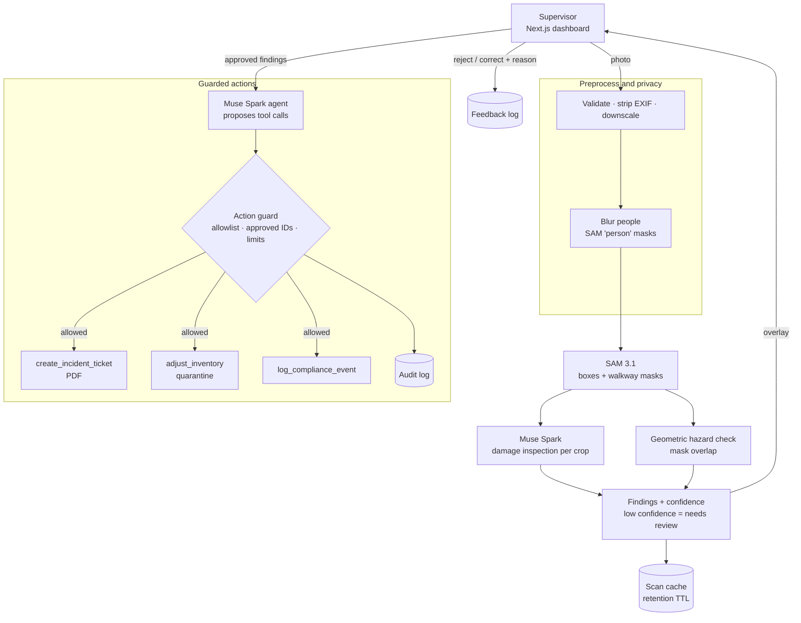

# AIsleEye

**Warehouse floor copilot: one photo in, damage and hazard tickets out.**

AIsleEye turns a single phone photo of a warehouse aisle or pallet into actionable operations data. It segments every box and floor marking, inspects each box for physical damage, detects pedestrian walkways blocked by freight, and — once a supervisor approves — an agent automatically files incident tickets, quarantines damaged inventory and logs compliance events.

It is built entirely on Meta's latest models via the [Meta Model API](https://dev.meta.ai/docs/overview):

| Capability | Model |
|---|---|
| Text-prompted segmentation (boxes + pixel masks) | `sam-3.1` |
| Visual damage inspection with schema-constrained JSON | `muse-spark-1.3` |
| Agentic tool calling (tickets, inventory, compliance) | `muse-spark-1.3` (optionally `muse-wonder-1.0`) |

---

## Table of contents

- [Why](#why)
- [How it works](#how-it-works)
- [Architecture](#architecture)
- [Tech stack](#tech-stack)
- [Project structure](#project-structure)
- [Getting started](#getting-started)
- [API](#api)
- [Branching and versioning](#branching-and-versioning)
- [Roadmap](#roadmap)
- [Guardrails, privacy and data handling](#guardrails-privacy-and-data-handling)
- [Datasets](#datasets)

---

## Why

Small and mid-sized warehouses still rely on manual floor walks and clipboards:

- **Damaged freight is found late** — usually at dispatch or by the customer.
- **Blocked walkways are a top safety risk**, but audits are periodic and paper-based.
- **Inventory and safety live in separate systems**, so one walk produces two sets of manual paperwork.

AIsleEye collapses that into one scan with a human in the loop.

## How it works

1. **Scan** — a supervisor uploads a photo of an aisle or pallet.
2. **Preprocess** — the upload is validated (type, size, content), oriented, stripped of metadata and downscaled.
3. **Protect privacy** 🚧 — people in the photo are segmented and blurred before anything is stored, cropped or passed to later stages.
4. **Segment** — SAM 3.1 is prompted with concepts such as `cardboard box` and `floor tape`, returning a box and a pixel mask for every instance.
5. **Inspect** — each box crop is sent to Muse Spark with a strict JSON schema (`damaged`, `damage_type`, `severity`, `confidence`, `reason`).
6. **Detect hazards** — walkway blockage is computed **geometrically** (box mask ∩ walkway mask), not guessed by a model, so it is deterministic and explainable.
7. **Review** — findings are shown on the image overlay with severity and confidence. Low-confidence results and scans with nothing detected are flagged **needs human review** 🚧. The supervisor approves, rejects or corrects each finding, and rejections are kept as feedback 🚧.
8. **Guard** 🚧 — an action guard checks every tool call the agent proposes against the approved findings before it runs.
9. **Dispatch** — a Muse Spark agent calls tools to create a PDF incident ticket, move damaged units to quarantine and append a compliance log entry. Every tool argument is validated before execution, and each action is written to an append-only audit log 🚧.

🚧 marks capabilities that are planned (see the [Roadmap](#roadmap)).

## Architecture



The privacy blur, action guard, feedback log and audit log are planned (Phase 5); the rest follows Phases 1 to 3.

## Tech stack

| Layer | Choice |
|---|---|
| Frontend | Next.js 16 (App Router), React 19, TypeScript, Tailwind CSS 4 |
| Backend | Python 3.13, FastAPI, Pydantic v2, OpenAI SDK (pointed at Meta Model API) |
| Segmentation parsing | [`meta-sam-parser`](https://dev.meta.ai/docs/sam/client-libraries) |
| Imaging / reports | Pillow, NumPy, ReportLab |
| Storage (MVP) | JSON / JSONL files on disk (inventory, tickets, audit and feedback logs) — no database required |
| CI/CD | GitHub Actions: branch-name check + automatic semantic releases |

## Project structure

```
.
├── backend/
│   ├── app/
│   │   ├── main.py          # FastAPI app, CORS, /health
│   │   ├── config.py        # Settings loaded from the root .env
│   │   └── clients.py       # Meta Model API client + image helpers
│   ├── scripts/
│   │   └── smoke_test.py    # Verifies every model capability end to end
│   └── requirements.txt
├── frontend/
│   └── src/
│       ├── app/             # Dashboard page, layout, dark industrial theme
│       ├── components/      # UI components (e.g. backend status)
│       └── lib/api.ts       # Typed API client
└── .github/
    ├── scripts/next_version.sh
    └── workflows/           # branch-name.yml, release.yml
```

## Getting started

### Prerequisites

- Python 3.10+ (3.13 recommended)
- Node.js 20.17+ and npm
- A Meta Model API key from the [developer dashboard](https://dev.meta.ai/)

### 1. Configure environment

Create a `.env` file in the repository root (it is git-ignored):

```dotenv
MODEL_API_KEY=your_key_here
MODEL_API_BASE_URL=https://api.meta.ai/v1
MUSE_MODEL=muse-spark-1.3
SAM_MODEL=sam-3.1
MUSE_AGENT_MODEL=muse-wonder-1.0
REQUEST_TIMEOUT_S=90
CORS_ORIGINS=["http://localhost:3000"]
```

Only `MODEL_API_KEY` is required; the rest have sensible defaults.

### 2. Backend

```bash
cd backend
python3 -m venv .venv
.venv/bin/pip install -r requirements.txt

# Verify text, vision, structured output, tool calling and SAM 3.1
.venv/bin/python -m scripts.smoke_test --image path/to/warehouse.jpg

# Run the API
.venv/bin/uvicorn app.main:app --reload --port 8000
```

The smoke test prints `PASS`/`FAIL` per capability and saves raw outputs to `backend/data/smoke/`. Without `--image` it renders a synthetic scene.

### 3. Frontend

```bash
cd frontend
echo "NEXT_PUBLIC_API_URL=http://localhost:8000" > .env.local
npm install
npm run dev
```

Open <http://localhost:3000>. The status indicator in the header turns green when the backend is reachable.

## API

| Method | Path | Status | Purpose |
|---|---|---|---|
| GET | `/health` | ✅ available | Liveness and configured models |
| POST | `/scan` | 🚧 planned | Image → segmented boxes, walkway mask and findings |
| POST | `/scan/{scan_id}/approve` | 🚧 planned | Run the agent on approved findings |
| GET | `/inventory` | 🚧 planned | Current inventory, including quarantine |
| GET | `/tickets` | 🚧 planned | Incident tickets |
| GET | `/tickets/{id}.pdf` | 🚧 planned | Ticket PDF |
| GET | `/compliance` | 🚧 planned | Compliance log |
| POST | `/scan/{scan_id}/feedback` | 🚧 planned | Reject or correct a finding, with a reason |
| DELETE | `/scan/{scan_id}` | 🚧 planned | Purge a cached scan |
| GET | `/audit` | 🚧 planned | Audit log of agent actions |

**Finding schema**

```json
{
  "id": "f_01",
  "type": "box_damage | walkway_blocked",
  "severity": "low | medium | high",
  "confidence": 0.0,
  "bbox": { "x1": 0, "y1": 0, "x2": 0, "y2": 0 },
  "description": "string",
  "sku": "optional string",
  "needs_review": false,
  "review_reason": "optional string"
}
```

`needs_review` and `review_reason` are planned (Phase 5): a low-confidence finding is flagged for a person instead of being presented as certain.

## Branching and versioning

Releases follow [Semantic Versioning](https://semver.org/) and are **fully automated**. A version is published only when a pull request is **merged into `master`**; the bump is derived from the source branch prefix.

| Branch prefix | Bump | Example from `v1.4.2` |
|---|---|---|
| `major/*`, `breaking/*` | major | `v2.0.0` |
| `release/*`, `feature/*`, `feat/*` | minor | `v1.5.0` |
| `fix/*`, `bug/*`, `bugfix/*`, `hotfix/*` | patch | `v1.4.3` |
| `chore/*`, `docs/*`, `ci/*`, `refactor/*`, `test/*` | none | `v1.4.2` |

- Branch names must match `<type>/<short-name>` (lowercase, `a-z0-9._-`); the **Branch name check** workflow enforces this on every PR to `master`.
- The **Release** workflow reads the latest `vX.Y.Z` tag, computes the next version with [`.github/scripts/next_version.sh`](.github/scripts/next_version.sh), tags the merge commit and publishes a GitHub Release with generated notes.
- Git tags are the single source of truth for the version. The project starts at **`v0.0.1`**.

Example:

```bash
git switch -c fix/sam-mask-offset
# ...commit...
git push -u origin fix/sam-mask-offset
gh pr create --base master --fill
# merge the PR → v0.0.2 is released automatically
```

> Protect `master` so changes land only through pull requests; direct pushes do not produce releases.

## Roadmap

- [x] **Phase 0** — Project scaffold, Meta Model API client, capability smoke test, dashboard shell, CI release pipeline
- [ ] **Phase 1** — Vision pipeline: SAM 3.1 segmentation, box crops, damage inspection, geometric hazard detection, `/scan`
- [ ] **Phase 2** — Agent and tools: ticket PDFs, inventory quarantine, compliance log, `/approve`
- [ ] **Phase 3** — Frontend: upload, mask overlays, findings review, agent action timeline, live KPIs
- [ ] **Phase 4** — Demo assets and offline replay mode
- [ ] **Phase 5** — Data handling, privacy and guardrails: shared preprocessing, people blur, retention and purge, agent action guard, audit log, needs-review and feedback flow, dataset preparation and label audit
- [ ] **Phase 6** — Hardening: timeouts and retries, prompt-injection regression cases, accuracy evaluation on audited labels
- [ ] **Later** — Video scans, on-device inference with Muse Glimmer, PPE and spill detection

## Guardrails, privacy and data handling

AIsleEye treats model output as untrusted, assumes photos may contain people, and expects labels (from models and from datasets) to be wrong sometimes. The scan pipeline and agent (Phases 1 to 2) are still in progress, so this section describes the design they are being built to; items marked 🚧 are the Phase 5 additions.

### Agent guardrails

- **Human in the loop** — the agent never acts on findings until a supervisor approves them.
- **Tool allowlist** — the agent can call exactly three tools; any other tool name is rejected.
- **Validated arguments** — structured outputs are schema-constrained and every tool argument is validated before execution.
- **Action guard** 🚧 — a policy layer between the agent and the tools. Only approved findings can be acted on, inventory changes cannot exceed the detected units or go below zero, each scan has an action and iteration cap, and duplicates of open tickets are merged. A rejected call returns its reason to the agent and to the dashboard.
- **Audit log** 🚧 — every executed or rejected action is appended to an append-only log (timestamp, scan, finding, tool, arguments, outcome). It never contains image data.
- **Untrusted content** — text visible inside images (labels, signage) is never treated as instructions. Model-written text is length-limited and stripped of markup and links before it reaches a PDF or log 🚧.
- **Optional safety classifier** 🚧 — a text safety check on agent output. Llama Guard would be used only if the Model API offers it, which has not been verified.

### Privacy

- **What leaves your machine** — the preprocessed photo is sent to the Meta Model API for inference. Review the API's data terms before using real facility photos.
- **Metadata** — uploads are size- and type-limited, stripped of EXIF (GPS, device) and downscaled.
- **People** 🚧 — people are segmented (`person`) and blurred before anything is cached, cropped into a ticket PDF or passed to later model calls. The detection pass itself sees the unblurred image, so blurring protects stored data and later stages, not that first call. If the pass fails, crops are left out of tickets and the scan is flagged.
- **Minimal storage** — original uploads are not stored, only derived results. There are no user accounts, and scan IDs are content hashes.
- **Retention** 🚧 — cached scans expire after a configurable number of days (`CACHE_TTL_DAYS`) and can be purged on demand with `DELETE /scan/{scan_id}`.
- **Secrets** — API keys live only in the git-ignored root `.env`; nothing secret is committed.

### Data quality and mislabelled data

- **Needs human review** 🚧 — findings below a configurable confidence threshold are flagged `needs_review` instead of being presented as certain. A scan with nothing detected is an explicit "nothing found" result, never a silent pass, and an image that does not look like a warehouse scene is called out.
- **Supervisor feedback** 🚧 — a supervisor can reject or correct a finding with a reason. Feedback is kept in a feedback log and used to evaluate the models; nothing is retrained automatically.
- **Dataset preprocessing** 🚧 — a preparation script samples images, applies the same preprocessing as uploads, renames files by content hash, removes near-duplicates by perceptual hash and writes a manifest with each image's source, license and label.
- **Label audit** 🚧 — before a dataset is used as ground truth, its labels are checked (schema, class balance, duplicates across splits). Where the model and the label disagree, a person reviews the image; mislabelled or ambiguous images are quarantined and excluded from the metrics.

## Datasets

For evaluation and demos (no training is required — all models are used zero-shot):

| Dataset | Use | License |
|---|---|---|
| [LOCO — Logistics Objects in Context](https://github.com/tum-fml/loco) | Real warehouse scenes | CC0 |
| [SCD — Stacked Carton Dataset](https://github.com/yancie-yjr/scd.github.io) | Carton segmentation and counting | CC BY-NC-SA 4.0 |
| [Industrial Quality Control of Packages](https://www.kaggle.com/datasets/christianvorhemus/industrial-quality-control-of-packages) | Damaged vs intact packages (synthetic) | GPL-2.0 |
| Self-captured walkway photos | Blocked-walkway scenarios | Own |

Non-commercial datasets are used for evaluation only. Every evaluation image goes through the same preprocessing as an upload and a label audit (see [Guardrails, privacy and data handling](#guardrails-privacy-and-data-handling)) before it counts toward a metric; mislabelled or ambiguous images are excluded rather than silently corrected.
