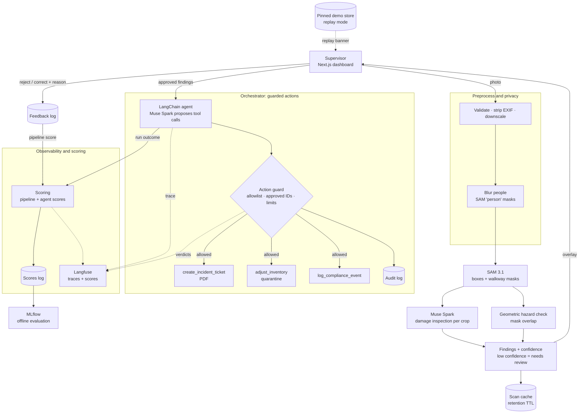

# AIsleEye

**Warehouse floor copilot: one photo in, damage and hazard tickets out.**

AIsleEye turns a single phone photo of a warehouse aisle or pallet into actionable operations data. It segments every box and floor marking, inspects each box for physical damage, detects pedestrian walkways blocked by freight, and — once a supervisor approves — an agent automatically files incident tickets, quarantines damaged inventory and logs compliance events.

It is built entirely on Meta's latest models via the [Meta Model API](https://dev.meta.ai/docs/overview):

| Capability | Model |
|---|---|
| Text-prompted segmentation (boxes + pixel masks) | `sam-3.1` |
| Visual damage inspection with schema-constrained JSON | `muse-spark-1.3` |
| Agentic tool calling (tickets, inventory, compliance) | `muse-spark-1.3` through a LangChain agent (optionally `muse-wonder-1.0`) |

Agent runs are traced with Langfuse and scored from automatic checks and reviewer feedback, and offline evaluations are tracked with MLflow (planned, Phase 6).

---

## Table of contents

- [Why](#why)
- [How it works](#how-it-works)
- [Architecture](#architecture)
- [Tech stack](#tech-stack)
- [Project structure](#project-structure)
- [Getting started](#getting-started)
- [Testing](#testing)
- [API](#api)
- [Branching and versioning](#branching-and-versioning)
- [Roadmap](#roadmap)
- [Guardrails, privacy and data handling](#guardrails-privacy-and-data-handling)
- [Reliability and interface](#reliability-and-interface)
- [Datasets](#datasets)

---

## Why

Small and mid-sized warehouses still rely on manual floor walks and clipboards:

- **Damaged freight is found late** — usually at dispatch or by the customer.
- **Blocked walkways are a top safety risk**, but audits are periodic and paper-based.
- **Inventory and safety live in separate systems**, so one walk produces two sets of manual paperwork.

AIsleEye collapses that into one scan with a human in the loop.

## How it works

1. **Scan** — a supervisor uploads a photo of an aisle or pallet, or takes one with the phone camera 🚧.
2. **Preprocess** — the upload is validated (type, size, content), oriented, stripped of metadata and downscaled.
3. **Protect privacy** 🚧 — people in the photo are segmented and blurred before anything is stored, cropped or passed to later stages.
4. **Segment** — SAM 3.1 is prompted with concepts such as `cardboard box` and `floor tape`, returning a box and a pixel mask for every instance.
5. **Inspect** — each box crop is sent to Muse Spark with a strict JSON schema (`damaged`, `damage_type`, `severity`, `confidence`, `reason`).
6. **Detect hazards** — walkway blockage is computed **geometrically** (box mask ∩ walkway region), not guessed by a model, so it is deterministic and explainable. A box standing on tape hides the tape under it, so the tape mask is closed over gaps up to the box's own size before the overlap is measured; a box is flagged when more than 15% of its area lies on the walkway.
7. **Review** — findings are shown on the image overlay with severity and confidence. Low-confidence results and scans with nothing detected are flagged **needs human review** 🚧. The supervisor approves, rejects or corrects each finding, and rejections are kept as feedback 🚧.
8. **Guard** 🚧 — an action guard checks every tool call the agent proposes against the approved findings before it runs.
9. **Dispatch** — a LangChain agent (Muse Spark, LangGraph runtime) calls tools to create a PDF incident ticket, move damaged units to quarantine and append a compliance log entry. Every tool argument is validated before execution, and each action is written to an append-only audit log 🚧.
10. **Trace and score** 🚧 — one Langfuse trace per scan covers every stage, model call, tool call and guard verdict (never images). Each agent run gets automatic scores (the agent score). The supervisor's approve, reject and correct decisions on findings become a separate pipeline score on the same trace, because that review judges the vision stages, not the agent.

🚧 marks capabilities that are planned (see the [Roadmap](#roadmap)).

## Architecture



The privacy blur, action guard, feedback log and audit log are planned (Phase 5); Langfuse tracing, scoring and MLflow evaluation are planned (Phase 6); the pinned demo store and replay mode are planned (Phase 4); the rest follows Phases 1 to 3.

## Tech stack

| Layer | Choice |
|---|---|
| Frontend | Next.js 16 (App Router), React 19, TypeScript, Tailwind CSS 4 |
| Backend | Python 3.13, FastAPI, Pydantic v2, OpenAI SDK (pointed at Meta Model API), LangChain + LangGraph for the agent stage 🚧 |
| Segmentation parsing | [`meta-sam-parser`](https://dev.meta.ai/docs/sam/client-libraries) |
| Imaging / reports | Pillow, NumPy, ReportLab |
| Storage (MVP) | JSON / JSONL files on disk (inventory, tickets, audit, feedback and score logs) — no database required |
| Agent tracing | Langfuse — optional, a no-op when not configured 🚧 |
| Offline evaluation | MLflow — local store, evaluation runs only 🚧 |
| CI/CD | GitHub Actions: branch-name check + automatic semantic releases |

## Project structure

```
.
├── backend/
│   ├── app/
│   │   ├── main.py          # FastAPI app, CORS, /health
│   │   ├── config.py        # Settings loaded from the root .env
│   │   ├── clients.py       # Meta Model API client + image helpers
│   │   └── pipeline/        # SAM segmentation, damage inspection, hazards, /scan orchestration
│   ├── scripts/
│   │   └── smoke_test.py    # Verifies every model capability end to end
│   ├── tests/               # pytest suite (offline)
│   ├── requirements.txt
│   └── requirements-dev.txt
├── frontend/
│   └── src/
│       ├── app/             # Dashboard page, layout, dark industrial theme
│       ├── components/      # UI components (e.g. backend status)
│       └── lib/api.ts       # Typed API client
└── .github/
    ├── scripts/next_version.sh
    └── workflows/           # ci.yml, branch-name.yml, release.yml
```

## Getting started

### Prerequisites

- Python 3.10+ (3.13 recommended)
- Node.js 20.17+ and npm
- A Meta Model API key from the [developer dashboard](https://dev.meta.ai/)

### 1. Configure environment

Copy the example file to the repository root and add your key (`.env` is git-ignored):

```bash
cp .env.example .env   # then set MODEL_API_KEY
```

Only `MODEL_API_KEY` is required. [`.env.example`](.env.example) lists every setting with its default; the Langfuse keys stay empty unless you enable tracing, and `MUSE_MODEL`, `SAM_MODEL` and `MUSE_AGENT_MODEL` must be Standard mode models (the app refuses `*-contributor` IDs, see [Privacy](#privacy)).

### 2. Backend

```bash
cd backend
python3 -m venv .venv
.venv/bin/pip install -r requirements.txt

# Verify text, vision, structured output, tool calling, SAM 3.1, a LangChain agent (and Langfuse if configured)
.venv/bin/python -m scripts.smoke_test --image path/to/warehouse.jpg

# Time vision and structured calls at each reasoning effort
.venv/bin/python -m scripts.smoke_test --latency

# Run the API
.venv/bin/uvicorn app.main:app --reload --port 8000
```

The smoke test prints `PASS`, `FAIL` or `SKIP` (an optional integration that is not configured) per capability and saves raw outputs and `report.json` to `backend/data/smoke/`. Without `--image` it renders a synthetic scene.

#### Local Langfuse (optional)

Traces stay on your machine when you run Langfuse yourself. With Docker running:

```bash
scripts/langfuse-local.sh up       # pulls missing images, starts the stack, writes the keys to your .env
scripts/langfuse-local.sh status   # down | logs | reset (reset also deletes the data volumes)
```

The stack is defined in [`infra/langfuse/docker-compose.yml`](infra/langfuse/docker-compose.yml): Langfuse web and worker, Postgres, ClickHouse, Redis and MinIO. Secrets are generated into the git-ignored `infra/langfuse/.env`, every published port is bound to `127.0.0.1`, telemetry is off and sign-up is closed. The UI is at http://localhost:3000 (login `admin@aisleeye.local`, password in `infra/langfuse/.env`); the script sets `LANGFUSE_ENABLED`, `LANGFUSE_PUBLIC_KEY`, `LANGFUSE_SECRET_KEY` and `LANGFUSE_BASE_URL` in the root `.env`, and the smoke test's Langfuse check then sends one LangChain trace. This Langfuse version only accepts OpenTelemetry traces, so the legacy `/api/public/traces` endpoint is unavailable; use the UI or `/api/public/v2/observations`.

#### What the live smoke test established

| Question | Answer |
|---|---|
| Do text, image, structured output and tool calling work on `muse-spark-1.3`? | Yes, all four. |
| Does SAM 3.1 return parseable boxes and masks? | Yes; one concept per request, and the reported frame (`w`/`h`) equals the image sent. |
| Which phrase finds walkway tape? | `floor tape` and `floor safety tape` matched nothing on the test scene; colour phrases did (`yellow line` 0.90, `yellow floor tape` 0.60). The default is `WALKWAY_CONCEPT=yellow line`; verify on real photos. |
| Does a LangChain agent work against the Meta API? | Yes: `create_agent` over Chat Completions completes a tool call and a final answer (about 5 s); the Responses API also works but returns block-list content and took about 8 s. `AGENT_RUNTIME=langchain` stays the default. |
| Which reasoning efforts are valid? | `minimal`, `low`, `medium`, `high`, `xhigh`, `max`; `none` is rejected. |
| How long does a call take? | One image call took 15 s by default and 2.8 s at `minimal` (110 vs 1442 output tokens); `low` 5.6 s, `medium` 10.9 s, `high` 12.8 s. The default is `MUSE_REASONING_EFFORT=minimal`; check inspection quality on real photos before lowering it further. |

Per-image latency was measured on one synthetic scene; treat it as a baseline, not a guarantee.

### 3. Frontend

```bash
cd frontend
echo "NEXT_PUBLIC_API_URL=http://localhost:8000" > .env.local
npm install
npm run dev
```

Open <http://localhost:3000>. The status indicator in the header turns green when the backend is reachable.

## Testing

Unit tests run offline — model calls are faked, so no API key or network is needed.

```bash
# Backend (pytest): config, API client, /health + CORS, smoke-test parsers, release versioning script
cd backend
.venv/bin/pip install -r requirements-dev.txt
.venv/bin/python -m pytest

# Frontend (Vitest + React Testing Library): API client, backend status, dashboard
cd frontend
npm test            # or: npm run test:watch
```

The **CI** workflow runs backend tests, frontend lint, tests and production build on every pull request to `master`. The live `scripts.smoke_test` stays a manual check because it calls the real Meta Model API.

## API

| Method | Path | Status | Purpose |
|---|---|---|---|
| GET | `/health` | ✅ available | Liveness and configured models |
| POST | `/scan` | ✅ available | Image → segmented boxes, walkway mask and findings |
| GET | `/scan/{scan_id}` | ✅ available | Cached scan result (demo replay) |
| POST | `/scan/{scan_id}/approve` | 🚧 planned | Run the agent on approved findings; returns actions, tickets and a `trace_id`; idempotent, so a repeat call returns the first result |
| GET | `/inventory` | 🚧 planned | Current inventory, including quarantine |
| GET | `/tickets` | 🚧 planned | Incident tickets |
| GET | `/tickets/{id}.pdf` | 🚧 planned | Ticket PDF |
| GET | `/compliance` | 🚧 planned | Compliance log |
| POST | `/scan/{scan_id}/feedback` | 🚧 planned | Reject or correct a finding, with a reason; also records a pipeline score on the scan's trace |
| DELETE | `/scan/{scan_id}` | 🚧 planned | Purge a cached scan |
| GET | `/audit` | 🚧 planned | Audit log of agent actions |
| GET | `/scores` | 🚧 planned | Pipeline score and agent score summaries: components, sample sizes, breakdown by prompt version |
| POST | `/tickets/{ticket_id}/feedback` | 🚧 planned (optional) | Rate a created ticket, with an optional corrected team or severity; feeds the agent score |

**Finding schema**

```json
{
  "id": "f_01",
  "type": "box_damage | walkway_blocked",
  "severity": "low | medium | high",
  "confidence": 0.0,
  "bbox": { "x1": 0, "y1": 0, "x2": 0, "y2": 0 },
  "description": "string",
  "sku": "optional string",
  "needs_review": false,
  "review_reason": "optional string"
}
```

`needs_review` and `review_reason` are planned (Phase 5): a low-confidence finding is flagged for a person instead of being presented as certain.

## Branching and versioning

Releases follow [Semantic Versioning](https://semver.org/) and are **fully automated**. A version is published only when a pull request is **merged into `master`**; the bump is derived from the source branch prefix.

| Branch prefix | Bump | Example from `v1.4.2` |
|---|---|---|
| `major/*`, `breaking/*` | major | `v2.0.0` |
| `release/*`, `feature/*`, `feat/*` | minor | `v1.5.0` |
| `fix/*`, `bug/*`, `bugfix/*`, `hotfix/*` | patch | `v1.4.3` |
| `chore/*`, `docs/*`, `ci/*`, `refactor/*`, `test/*` | none | `v1.4.2` |

- Branch names must match `<type>/<short-name>` (lowercase, `a-z0-9._-`); the **Branch name check** workflow enforces this on every PR to `master`.
- The **Release** workflow reads the latest `vX.Y.Z` tag, computes the next version with [`.github/scripts/next_version.sh`](.github/scripts/next_version.sh), tags the merge commit and publishes a GitHub Release with generated notes.
- Git tags are the single source of truth for the version. The project starts at **`v0.0.1`**.

Example:

```bash
git switch -c fix/sam-mask-offset
# ...commit...
git push -u origin fix/sam-mask-offset
gh pr create --base master --fill
# merge the PR → v0.0.2 is released automatically
```

> Protect `master` so changes land only through pull requests; direct pushes do not produce releases.

## Roadmap

- [x] **Phase 0** — Project scaffold, Meta Model API client, capability smoke test, dashboard shell, CI release pipeline
- [x] **Phase 1** — Vision pipeline: SAM 3.1 segmentation, box crops, damage inspection, geometric hazard detection, `/scan`
- [ ] **Phase 2** — Agent and tools: LangChain agent, ticket PDFs, inventory quarantine, compliance log, idempotent `/approve`, safe file writes
- [ ] **Phase 3** — Frontend: phone camera upload, mask overlays that do not rely on colour alone, findings review, agent action timeline, live KPIs, main empty and error states
- [ ] **Phase 4** — Demo assets, a pinned demo store and offline replay mode with a visible replay banner
- [ ] **Phase 5** — Data handling, privacy and guardrails: shared preprocessing, people blur, retention and purge, agent action guard, audit log, needs-review and feedback flow, dataset preparation and label audit
- [ ] **Phase 6** — Agent observability, scoring and evaluation: Langfuse traces without image data, central orchestrator with separate pipeline and agent scores (reviewer feedback scores the vision stages, the agent score is automatic), both shown in the dashboard with their sample sizes, MLflow evaluation runs on audited labels
- [ ] **Phase 7** — Hardening: timeouts and retries, prompt-injection regression cases, tracing and evaluation failure drills, accuracy evaluation on audited labels
- [ ] **Phase 8** — Demo prep: final demo freeze, one-command demo start, pre-demo checklist, dataset attribution, backup video
- [ ] **Later** — Video scans, on-device inference with Muse Glimmer, PPE and spill detection

## Guardrails, privacy and data handling

AIsleEye treats model output as untrusted, assumes photos may contain people, and expects labels (from models and from datasets) to be wrong sometimes. The scan pipeline and agent (Phases 1 to 2) are still in progress, so this section describes the design they are being built to; items marked 🚧 are the Phase 5 and 6 additions.

### Agent guardrails

- **Human in the loop** — the agent never acts on findings until a supervisor approves them.
- **Tool allowlist** — the agent can call exactly three tools; any other tool name is rejected.
- **Validated arguments** — structured outputs are schema-constrained and every tool argument is validated before execution.
- **Action guard** 🚧 — a policy layer between the agent and the tools. Only approved findings can be acted on, inventory changes cannot exceed the detected units or go below zero, each scan has an action and iteration cap, and duplicates of open tickets are merged. A rejected call returns its reason to the agent and to the dashboard.
- **Audit log** 🚧 — every executed or rejected action is appended to an append-only log (timestamp, scan, finding, tool, arguments, outcome). It never contains image data.
- **Untrusted content** — text visible inside images (labels, signage) is never treated as instructions. Model-written text is length-limited and stripped of markup and links before it reaches a PDF or log 🚧.
- **Optional safety classifier** 🚧 — a text safety check on agent output. Llama Guard would be used only if the Model API offers it, which has not been verified.

### Privacy

- **What leaves your machine** — the preprocessed photo is sent to the Meta Model API for inference. In Standard mode (`muse-spark-1.3`, `sam-3.1`, `muse-wonder-1.0`) Meta states that prompts, files and responses are not used to train its models; the `*-contributor` Muse Spark variants are cheaper in exchange for allowing exactly that, so the app refuses them. Check the current [data terms](https://dev.meta.ai/docs/pricing-rate-limits#pricing-modes) before using real facility photos. Tracing runs against a local, self-hosted Langfuse by default (`LANGFUSE_BASE_URL=http://localhost:3000`), so prompts, model outputs, tool arguments and scores stay on this machine and never go to a third party; images are never traced either (see below). Pointing `LANGFUSE_BASE_URL` at Langfuse Cloud would send those texts to a third-party processor.
- **Cost and limits** — pay-as-you-go prices from the [pricing page](https://dev.meta.ai/docs/pricing-rate-limits): SAM 3.1 $2.50 per 1,000 images (a scan makes two calls, about $0.005); `muse-spark-1.3` $1.25 per million input and $4.25 per million output tokens. A scan with a handful of crops at minimal reasoning is roughly two to three cents; measure it from `usage` once real photos run. Limits per team: 3,000 requests per minute for `sam-3.1` and `muse-spark-1.3` (4 M tokens per minute for Muse). The client retries 429s and 5xx responses twice.
- **Metadata** — uploads are size- and type-limited, stripped of EXIF (GPS, device) and downscaled.
- **People** 🚧 — people are segmented (`person`) and blurred before anything is cached, cropped into a ticket PDF or passed to later model calls. The detection pass itself sees the unblurred image, so blurring protects stored data and later stages, not that first call. If the pass fails, crops are left out of tickets and the scan is flagged.
- **Minimal storage** — original uploads are not stored, only derived results. There are no user accounts, and scan IDs are content hashes.
- **Retention** 🚧 — cached scans expire after a configurable number of days (`CACHE_TTL_DAYS`) and can be purged on demand with `DELETE /scan/{scan_id}`; neither touches the pinned demo store used for replay.
- **Secrets** — API keys (Meta Model API, and Langfuse if enabled) live only in the git-ignored root `.env`; nothing secret is committed.

### Data quality and mislabelled data

- **Needs human review** 🚧 — findings below a configurable confidence threshold are flagged `needs_review` instead of being presented as certain. A scan with nothing detected is an explicit "nothing found" result, never a silent pass, and an image that does not look like a warehouse scene is called out.
- **Supervisor feedback** 🚧 — a supervisor can reject or correct a finding with a reason. Feedback is kept in a feedback log, becomes a pipeline score (it judges the vision stages, not the agent; see below) and is used to evaluate the models; nothing is retrained automatically.
- **Dataset preprocessing** 🚧 — a preparation script samples images, applies the same preprocessing as uploads, renames files by content hash, removes near-duplicates by perceptual hash and writes a manifest with each image's source, license and label.
- **Label audit** 🚧 — before a dataset is used as ground truth, its labels are checked (schema, class balance, duplicates across splits). Where the model and the label disagree, a person reviews the image; mislabelled or ambiguous images are quarantined and excluded from the metrics.

### Agent tracing, scoring and evaluation

All of this is planned (Phase 6) and optional: with no Langfuse keys, or MLflow not installed, the app, the agent and the offline tests behave exactly as before.

- **Tracing** 🚧 — [Langfuse](https://langfuse.com) records one trace per scan: preprocessing, each SAM call, inspection batches, the hazard check, the agent run, every tool call and every guard verdict. Tracing is a no-op when unconfigured or unreachable and never fails a scan or an agent run.
- **No images in traces** 🚧 — masking at the Langfuse client drops image URLs, base64 payloads and crop bytes before export, and an offline test fails if any exported span contains one. Langfuse runs locally by default, so nothing is sent to a third party; if you point it at Langfuse Cloud, that service becomes a processor for prompts, outputs, tool arguments and scores.
- **Central orchestrator** 🚧 — the single entry point for an approved scan: it runs the LangChain agent, sends every proposed tool call through the action guard, closes the trace and scores the run. If LangChain misbehaves against the Meta Model API (which supports only automatic tool choice), `AGENT_RUNTIME=plain` runs a hand-written loop with the same tools.
- **Scoring** 🚧 — two separate scores, because the supervisor's review happens before the agent runs. The **pipeline score** comes from that review (`pipeline_human_agreement`: approved ÷ reviewed findings, where a correction counts as a miss) and judges segmentation and inspection. The **agent score** is automatic (tool-call validity, guard rejections, staying within the iteration cap; latency and tokens are recorded alongside), and an optional post-dispatch rating of the created tickets can be blended in later 🚧. Each score appears in the dashboard with its sample size, and only after a minimum number of reviews or runs. Scores are stored locally in `scores.jsonl` and mirrored to the scan's trace in Langfuse. Scoring is report-only: it never changes prompts, tools or permissions automatically.
- **Offline evaluation** 🚧 — MLflow tracks evaluation runs on the audited label set: prompt version, model names and thresholds as parameters; damage precision and recall, hazard accuracy, needs-review rate, latency and tokens as metrics; pipeline agreement and agent score per prompt version for comparison. MLflow is used for evaluation only (live traces stay in Langfuse and MLflow's LangChain autolog stays off, so nothing is traced twice) and ships as an optional extra (`requirements-eval.txt`).
- **Planned settings** 🚧 — `LANGFUSE_ENABLED`, `LANGFUSE_PUBLIC_KEY`, `LANGFUSE_SECRET_KEY`, `LANGFUSE_BASE_URL`, `AGENT_RUNTIME`, `SCORE_MIN_REVIEWS`, `MLFLOW_TRACKING_URI`, `MUSE_REASONING_EFFORT`, `DEMO_MODE`. The backend does not read them yet.

## Reliability and interface

Planned (Phases 2 to 4 and 8); items marked 🚧 are not built yet.

- **Safe state changes** 🚧 — inventory, ticket, compliance, audit, feedback and score files are written atomically (temp file, then rename, with a per-file lock). Approving a scan is idempotent: a repeated or double-clicked request returns the first result and creates no second ticket or inventory change.
- **Demo replay** 🚧 — pre-run results for the demo images live in a pinned store that the retention purge never touches. Replay mode, or an unavailable API, serves them behind a visible "replay" banner; replayed results are never presented as live.
- **Latency** 🚧 — the target is under 20 seconds for a scan plus approval. In testing, a trivial Muse Spark reply took 13.7 seconds at default reasoning, so inspection and the agent use a low reasoning effort, the SAM calls run concurrently, all crops go in one inspection request, and every stage's time is recorded.
- **Phone-first** 🚧 — upload takes a photo from the phone camera or the gallery, and narrow screens get a single-column layout with large touch targets.
- **Accessible overlays** 🚧 — colour is never the only signal: damaged boxes use red with a hatched fill and an icon, blocked walkways a yellow dashed outline and an icon, and every finding has a text label. Nothing flashes, and reduced-motion settings are honoured.
- **Main states** 🚧 — nothing detected, API unavailable, replay, people-blur failed, rejected findings and actions rejected by the guard each have an explicit, visible state.

## Datasets

For evaluation and demos (no training is required — all models are used zero-shot):

| Dataset | Use | License |
|---|---|---|
| [LOCO — Logistics Objects in Context](https://github.com/tum-fml/loco) | Real warehouse scenes | CC0 |
| [SCD — Stacked Carton Dataset](https://github.com/yancie-yjr/scd.github.io) | Carton segmentation and counting | CC BY-NC-SA 4.0 |
| [Industrial Quality Control of Packages](https://www.kaggle.com/datasets/christianvorhemus/industrial-quality-control-of-packages) | Damaged vs intact packages (synthetic) | GPL-2.0 |
| Self-captured walkway photos | Blocked-walkway scenarios | Own |

Non-commercial datasets are used for evaluation only. Every evaluation image goes through the same preprocessing as an upload and a label audit (see [Guardrails, privacy and data handling](#guardrails-privacy-and-data-handling)) before it counts toward a metric; mislabelled or ambiguous images are excluded rather than silently corrected.
