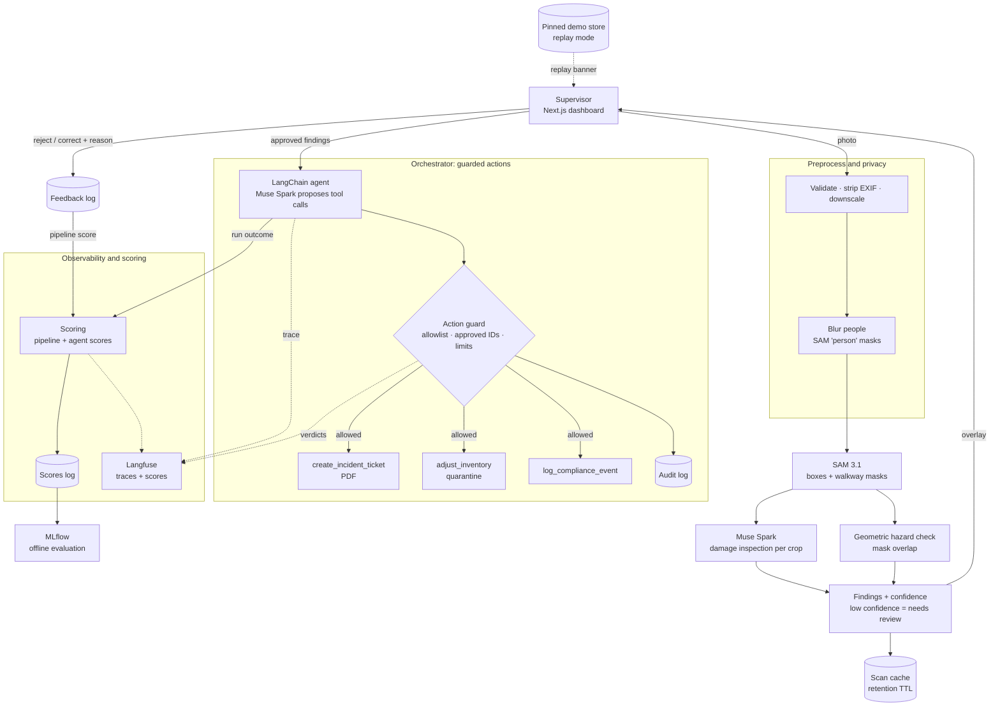

# AIsleEye

**Warehouse floor copilot: one photo in, damage and hazard tickets out.**

AIsleEye turns a single phone photo of a warehouse aisle or pallet into actionable operations data. It segments every box and floor marking, inspects each box for physical damage, detects pedestrian walkways blocked by freight, and — once a supervisor approves — an agent automatically files incident tickets, quarantines damaged inventory and logs compliance events.

It is built entirely on Meta's latest models via the [Meta Model API](https://dev.meta.ai/docs/overview):

| Capability | Model |
|---|---|
| Text-prompted segmentation (boxes + pixel masks) | `sam-3.1` |
| Visual damage inspection with schema-constrained JSON | `muse-spark-1.3` |
| Agentic tool calling (tickets, inventory, compliance) | `muse-spark-1.3` through a LangChain agent (optionally `muse-wonder-1.0`) |

Agent runs are traced with Langfuse and scored from automatic checks and reviewer feedback, and offline evaluations are tracked with MLflow.

---

## Table of contents

- [Why](#why)
- [How it works](#how-it-works)
- [Architecture](#architecture)
- [Tech stack](#tech-stack)
- [Project structure](#project-structure)
- [Getting started](#getting-started)
- [Testing](#testing)
- [API](#api)
- [Authentication and RBAC](#authentication-and-rbac)
- [Branching and versioning](#branching-and-versioning)
- [Roadmap](#roadmap)
- [Guardrails, privacy and data handling](#guardrails-privacy-and-data-handling)
- [Reliability and interface](#reliability-and-interface)
- [Datasets](#datasets)

---

## Why

Small and mid-sized warehouses still rely on manual floor walks and clipboards:

- **Damaged freight is found late** — usually at dispatch or by the customer.
- **Blocked walkways are a top safety risk**, but audits are periodic and paper-based.
- **Inventory and safety live in separate systems**, so one walk produces two sets of manual paperwork.

AIsleEye collapses that into one scan with a human in the loop.

## How it works

1. **Scan** — a supervisor uploads a photo of an aisle or pallet, or takes one with the phone camera 🚧.
2. **Preprocess** — the upload is validated (type, size, content), oriented, stripped of metadata and downscaled.
3. **Protect privacy** — a `person` SAM pass runs beside the detection passes; people are blurred (Gaussian) before any box crop is sent for inspection. The detection pass itself sees the original. If the pass fails, the scan is flagged `privacy: failed` and the dashboard says no crops are kept.
4. **Segment** — SAM 3.1 is prompted with concepts such as `cardboard box` and `floor tape`, returning a box and a pixel mask for every instance.
5. **Inspect** — each box crop is sent to Muse Spark with a strict JSON schema (`damaged`, `damage_type`, `severity`, `confidence`, `reason`).
6. **Detect hazards** — walkway blockage is computed **geometrically** (box mask ∩ walkway region), not guessed by a model, so it is deterministic and explainable. A box standing on tape hides the tape under it, so each walkway mask is first closed over gaps up to the box's own size; weak matches (below `WALKWAY_MIN_CONFIDENCE`) are ignored, and separate markings are never bridged. Overlap is measured in the photo, so a box in front of a lane can look like one on it; shoot from above where you can. A box is flagged when more than 15% of its area lies on the walkway.
7. **Review** — findings are shown on the image overlay with severity and confidence. Results below `REVIEW_CONFIDENCE` (0.6), damage found on a box the segmenter doubted, and boxes the inspection returned nothing for are flagged **needs human review**, and a photo with no freight says so. The supervisor approves or rejects each finding; a rejection is kept as feedback (a "correct" verdict exists in the API but has no button yet).
8. **Guard** — an action guard checks every tool call the agent proposes against the approved findings before it runs.
9. **Dispatch** — a LangChain agent (Muse Spark, LangGraph runtime) calls tools to create a PDF incident ticket, move damaged units to quarantine and append a compliance log entry. Every tool argument is validated before execution, and each action is written to an append-only audit log.
10. **Trace and score** — one Langfuse trace per scan covers every stage, model call, tool call and guard verdict (never images). Each agent run gets automatic scores (the agent score). The supervisor's approve, reject and correct decisions on findings become a separate pipeline score on the same trace, because that review judges the vision stages, not the agent.

🚧 marks capabilities that are planned (see the [Roadmap](#roadmap)).

## Architecture



The tracing, scoring and evaluation layers are optional (Phase 6); the rest, including the privacy blur, action guard, feedback log, audit log, pinned demo store and replay mode, is built.

## Tech stack

| Layer | Choice |
|---|---|
| Frontend | Next.js 16 (App Router), React 19, TypeScript, Tailwind CSS 4 |
| Backend | Python 3.13, FastAPI, Pydantic v2, OpenAI SDK (pointed at Meta Model API), LangChain + LangGraph for the agent stage 🚧 |
| Segmentation parsing | [`meta-sam-parser`](https://dev.meta.ai/docs/sam/client-libraries) |
| Imaging / reports | Pillow, NumPy, ReportLab |
| Storage (MVP) | JSON / JSONL files on disk (inventory, tickets, audit, feedback and score logs) — no database required |
| Agent tracing | Langfuse — optional, a no-op when not configured |
| Offline evaluation | MLflow — local store, evaluation runs only (`requirements-eval.txt`) |
| CI/CD | GitHub Actions: branch-name check + automatic semantic releases |

## Project structure

```
.
├── backend/
│   ├── app/
│   │   ├── main.py          # FastAPI app, CORS, /health
│   │   ├── config.py        # Settings loaded from the root .env
│   │   ├── clients.py       # Meta Model API client + image helpers
│   │   └── pipeline/        # SAM segmentation, damage inspection, hazards, /scan orchestration
│   ├── scripts/
│   │   └── smoke_test.py    # Verifies every model capability end to end
│   ├── tests/               # pytest suite (offline)
│   ├── requirements.txt
│   └── requirements-dev.txt
├── frontend/
│   └── src/
│       ├── app/             # Dashboard page, layout, dark industrial theme
│       ├── components/      # UI components (e.g. backend status)
│       └── lib/api.ts       # Typed API client
└── .github/
    ├── scripts/next_version.sh
    └── workflows/           # ci.yml, branch-name.yml, release.yml
```

## Getting started

### Prerequisites

- Python 3.10+ (3.13 recommended)
- Node.js 20.17+ and npm
- A Meta Model API key from the [developer dashboard](https://dev.meta.ai/)

### 1. Configure environment

Copy the example file to the repository root and add your key (`.env` is git-ignored):

```bash
cp .env.example .env   # then set MODEL_API_KEY
```

`MODEL_API_KEY` is required for model calls. HTTP operations also require the [OIDC and RBAC configuration](#authentication-and-rbac); `/health` remains public. [`.env.example`](.env.example) lists every setting with its default; the Langfuse keys stay empty unless you enable tracing, and `MUSE_MODEL`, `SAM_MODEL` and `MUSE_AGENT_MODEL` must be Standard mode models (the app refuses `*-contributor` IDs, see [Privacy](#privacy)).

### 2. Backend

```bash
cd backend
python3 -m venv .venv
.venv/bin/pip install -r requirements.txt

# Verify text, vision, structured output, tool calling, SAM 3.1, a LangChain agent (and Langfuse if configured)
.venv/bin/python -m scripts.smoke_test --image path/to/warehouse.jpg

# Time vision and structured calls at each reasoning effort
.venv/bin/python -m scripts.smoke_test --latency

# Run the API
.venv/bin/uvicorn app.main:app --reload --port 8000
```

The smoke test prints `PASS`, `FAIL` or `SKIP` (an optional integration that is not configured) per capability and saves raw outputs and `report.json` to `backend/data/smoke/`. Without `--image` it renders a synthetic scene.

#### Local Langfuse (optional)

Traces stay on your machine when you run Langfuse yourself. With Docker running:

```bash
scripts/langfuse-local.sh up       # pulls missing images, starts the stack, writes the keys to your .env
scripts/langfuse-local.sh status   # down | logs | reset (reset also deletes the data volumes)
```

The stack is defined in [`infra/langfuse/docker-compose.yml`](infra/langfuse/docker-compose.yml): Langfuse web and worker, Postgres, ClickHouse, Redis and MinIO. Secrets are generated into the git-ignored `infra/langfuse/.env`, every published port is bound to `127.0.0.1`, telemetry is off and sign-up is closed. The UI is at http://localhost:3000 (login `admin@aisleeye.local`, password in `infra/langfuse/.env`); the script sets `LANGFUSE_ENABLED`, `LANGFUSE_PUBLIC_KEY`, `LANGFUSE_SECRET_KEY` and `LANGFUSE_BASE_URL` in the root `.env`, and the smoke test's Langfuse check then sends one LangChain trace. This Langfuse version only accepts OpenTelemetry traces, so the legacy `/api/public/traces` endpoint is unavailable; use the UI or `/api/public/v2/observations`.

#### What the live smoke test established

| Question | Answer |
|---|---|
| Do text, image, structured output and tool calling work on `muse-spark-1.3`? | Yes, all four. |
| Does SAM 3.1 return parseable boxes and masks? | Yes; one concept per request, and the reported frame (`w`/`h`) equals the image sent. |
| Which phrase finds walkway tape? | `floor tape` and `floor safety tape` matched nothing on the test scene; colour phrases did (`yellow line` 0.90, `yellow floor tape` 0.60). The default is `WALKWAY_CONCEPT=yellow line`; verify on real photos. |
| Does a LangChain agent work against the Meta API? | Yes: `create_agent` over Chat Completions completes a tool call and a final answer (about 5 s); the Responses API also works but returns block-list content and took about 8 s. `AGENT_RUNTIME=langchain` stays the default. |
| Which reasoning efforts are valid? | `minimal`, `low`, `medium`, `high`, `xhigh`, `max`; `none` is rejected. |
| How long does a call take? | One image call took 15 s by default and 2.8 s at `minimal` (110 vs 1442 output tokens); `low` 5.6 s, `medium` 10.9 s, `high` 12.8 s. The default is `MUSE_REASONING_EFFORT=minimal`; check inspection quality on real photos before lowering it further. |

Per-image latency was measured on one synthetic scene; treat it as a baseline, not a guarantee.

### 3. Frontend

```bash
cd frontend
echo "NEXT_PUBLIC_API_URL=http://localhost:8000" > .env.local
npm install
npm run dev
```

Open <http://localhost:3001> (port 3000 is left to the optional local Langfuse). The status indicator in the header turns green when the backend is reachable.

> RBAC foundation increment: the existing dashboard does not yet implement OIDC login or authenticated PDF downloads. It can show backend health, but protected operations require an authenticated API client until the frontend integration lands. Do not deploy this increment as a complete replacement for the existing dashboard workflow.

**Demo photos and offline replay**

[`demo_images/`](demo_images) holds seven demo photos (two clean, two damaged, two with a box in the walkway and one mixed scene). They are drawn by [`backend/scripts/make_demo_images.py`](backend/scripts/make_demo_images.py), so they are synthetic and carry no third-party licence; real warehouse photos still need testing. Pick one under "Or try a demo photo" in the dashboard.

Each demo photo has a pinned result in `backend/data/demo/`, named by the hash of the photo. To run the whole demo with no network and no model:

```bash
DEMO_MODE=replay .venv/bin/uvicorn app.main:app --port 8000   # from backend/
```

In replay mode `POST /scan` answers only from the pinned store (then the cache), `/approve` dispatches with the built-in rules instead of the AI agent (same guard, same audit log), and the dashboard shows a replay banner for the whole session. A photo with no saved result gets a clear message, never an invented one. Outside replay mode a failing model API also falls back to the pinned result for a demo photo (banner included), and an approval whose AI agent fails before acting falls back to the rules.

```bash
.venv/bin/python -m scripts.make_demo_images        # redraw the photos and manifest
.venv/bin/python -m scripts.freeze_demo [name ...]  # re-run them live and re-pin the results
```

Re-freeze whenever preprocessing, the walkway settings or the thresholds change. The committed results were frozen with the final settings: all seven photos matched their expected counts.

**Running the demo**

```bash
scripts/demo.sh replay   # no key, no network: saved results only, with the replay banner
scripts/demo.sh          # live models; needs MODEL_API_KEY in the git-ignored .env
```

The script checks the virtualenv, the frontend dependencies, the key (live mode) and the ports, runs the pre-demo checks, builds the frontend on first use, starts both servers, waits until they answer and prints the URLs. Ctrl-C stops both. It never reads or prints the key. `scripts/demo.sh --skip-checks` starts anyway when a check fails.

`python -m scripts.predemo` (from `backend/`; `--live` adds one small model call to prove the key works) runs the checks that a machine can do: key set, demo photos present, a valid pinned result for each photo that matches its expected counts, every photo scanned and approved in replay mode with the model API pointed at a dead address, Langfuse reachable or disabled, and ports free. It then lists what stays manual: browser zoom and window size, a phone capture test, a backup screen video and rehearsals.

**Synthetic evaluation dataset**

Real photos are often licence-restricted, so you can generate a labelled, licence-free set instead (CC0, drawn in the repo):

```bash
.venv/bin/python -m scripts.generate_synthetic --count 25   # per class: damaged, intact, blocked, clear
.venv/bin/python -m scripts.audit_labels                    # then evaluate with scripts.evaluate as usual
```

It writes to the gitignored `datasets/` folder through the same preprocessing as an upload. Each image carries one label: damaged / intact scenes keep the walkway clear and blocked / clear scenes use undamaged boxes, so the label is unambiguous. Runs are seeded (`--seed`, `--out`, `--classes`) and re-running adds nothing new. The scenes are cartoon-style, so they test the pipeline, not real-world accuracy.

**Using the dashboard**

1. Take a photo (the rear camera opens on a phone) or choose one from the gallery. Photos must be JPEG, PNG or WebP and at most 10 MB.
2. The overlay marks every box as OK (green dots, ✓), damaged (red, ✕) or blocking a walkway (red hatch, ⚠ — it pulses once, and not at all with reduced motion); the walkway is a dashed yellow band. Every state also carries a text label.
3. In the findings panel, untick anything you do not want dispatched. For a damaged box you can enter its SKU so the agent can quarantine stock; nothing in the photo identifies it.
4. **Approve & Dispatch** runs the agent once (the button locks, so a double click cannot repeat it). The timeline lists every action with its status, including calls the guard blocked, and links each ticket PDF.
5. The KPI strip shows scans this session, open tickets, units in quarantine and walkway hazards in the current scan.

## Testing

Unit tests run offline — model calls are faked, so no API key or network is needed.

```bash
# Backend (pytest): config, API client, /health + CORS, smoke-test parsers, release versioning script
cd backend
.venv/bin/pip install -r requirements-dev.txt
.venv/bin/python -m pytest

# Frontend (Vitest + React Testing Library): API client, upload, overlay, findings, timeline, dashboard flows
cd frontend
npm test            # or: npm run test:watch
```

The **CI** workflow runs backend tests, frontend lint, tests and production build on every pull request to `master`. The live `scripts.smoke_test` stays a manual check because it calls the real Meta Model API.

## API

| Method | Path | Status | Purpose |
|---|---|---|---|
| GET | `/health` | ✅ available | Liveness and configured models |
| GET | `/me` | ✅ available | Authenticated identity, trusted scoped grants, and deployment-wide permissions |
| POST | `/scan` | ✅ available | Image → segmented boxes, walkway mask and findings |
| GET | `/scan/{scan_id}` | ✅ available | Cached scan result, or the pinned demo result flagged `replay: true` |
| POST | `/scan/{scan_id}/approve` | ✅ available | Body `{finding_ids, skus?}` (`skus` maps a finding to the SKU the supervisor entered). Runs the agent; returns actions with their status, tickets, summary and a `trace_id`; idempotent, so a repeat call returns the first result (`Idempotent-Replay: true`) |
| GET | `/inventory` | ✅ available | Current inventory, including quarantine |
| GET | `/tickets` | ✅ available | Incident tickets filtered by role, resource scope, and personal assignment |
| GET | `/tickets/{ticket_id}.pdf` | ✅ available | Ticket PDF with the same authorization as its ticket |
| GET | `/compliance` | ✅ available | Compliance log |
| POST | `/scan/{scan_id}/feedback` | ✅ available | Body `{finding_id, action: reject or correct, reason?, corrected_type?}`; appended to `data/feedback.jsonl`. Evaluation data only: it changes no setting or prompt. (The pipeline score on the trace is Phase 6.) |
| DELETE | `/scan/{scan_id}` | ✅ available | Purge a cached scan (204). The pinned demo store is out of reach: a demo id is a 404 |
| GET | `/audit` | ✅ available | Audit log of agent actions |
| GET | `/demo` | ✅ available | The demo photos, each with its scan id and whether a saved result exists |
| GET | `/demo/{name}.jpg` | ✅ available | One demo photo, byte for byte (its hash is the scan id of the saved result) |
| GET | `/scores` | ✅ available | Pipeline agreement and agent score with sample sizes (a value only once `SCORE_MIN_REVIEWS` is reached), components, and a breakdown by prompt version |
| POST | `/tickets/{ticket_id}/feedback` | 🚧 planned (optional) | Rate a created ticket, with an optional corrected team or severity; feeds the agent score |

All data endpoints require an OIDC bearer token; only `/health` and the API documentation/schema are public. Replay mode enforces the same permissions.

**Finding schema**

```json
{
  "id": "f_01",
  "type": "box_damage | walkway_blocked",
  "severity": "low | medium | high",
  "confidence": 0.0,
  "bbox": { "x1": 0, "y1": 0, "x2": 0, "y2": 0 },
  "description": "string",
  "sku": "optional string",
  "needs_review": false,
  "review_reason": "optional string"
}
```

`needs_review` and `review_reason` flag a finding for a person instead of presenting it as certain. A scan result also carries `privacy` (`off`, `blurred` or `failed`) and `uninspected_boxes`, the boxes the inspection gave no verdict on.

## Authentication and RBAC

This is the first, API-first RBAC increment: verified identity and protection of existing endpoints. Technician assignment, acknowledgement/resolution, notification delivery, reporter submission/status views, admin editing screens, and frontend login are not implemented yet.

### Identity and trusted access directory

Use an OIDC provider issuing **RS256-signed JWT access tokens** for a dedicated AIsleEye API audience. Configure the root `.env`:

```dotenv
OIDC_ISSUER=https://identity.example.com/
OIDC_AUDIENCE=aisleeye-api
OIDC_JWKS_URL=https://identity.example.com/.well-known/jwks.json
RBAC_USERS_FILE=backend/data/access.json
RBAC_WAREHOUSE_ID=warehouse-a
```

Use your provider's actual issuer, audience, and JWKS URL. Issuer and JWKS URLs must use HTTPS. The backend verifies signature, issuer, audience, expiry, issued-at, and subject; optional not-before claims are also enforced. Signing-key requests time out after five seconds, and key sets are cached for five minutes. Missing/invalid auth configuration or an unavailable access directory fails closed; there is no anonymous/demo bypass.

Create the deployment-controlled, git-ignored access directory before use:

```json
{
  "users": [
    {
      "subject": "oidc-subject-for-admin",
      "display_name": "Warehouse administrator",
      "active": true,
      "grants": [{"role": "admin", "warehouse_id": "warehouse-a"}]
    },
    {
      "subject": "oidc-subject-for-floor-manager",
      "display_name": "Floor manager",
      "grants": [{"role": "floor_manager", "warehouse_id": "warehouse-a"}]
    },
    {
      "subject": "oidc-subject-for-technician",
      "display_name": "Maintenance technician",
      "grants": [{"role": "technician", "warehouse_id": "warehouse-a", "team": "Maintenance"}]
    }
  ]
}
```

Replace subjects with exact provider subject identifiers. Provision the first admin explicitly; public signup cannot grant access. Relative directory paths resolve from the repository root regardless of backend working directory. Keep the file readable only by the service and deployment administrators, use atomic replacement when updating it, and do not commit real identities. User records are reloaded on every request, so disabling access or removing grants takes effect on the next request without waiting for token expiry.

For the MVP the directory is just this JSON file; there is no database. Instead of editing it by hand, use the CLI (from `backend/`), which validates every change against the same model the API uses and writes atomically (the file stays owner-only):

```bash
.venv/bin/python -m scripts.access add SUBJECT --name "Ada Admin" --role admin        # the first admin creates the file
.venv/bin/python -m scripts.access add SUBJECT --name "Tess" --role technician --team Maintenance --expires 2027-01-31T00:00:00+00:00
.venv/bin/python -m scripts.access grant SUBJECT --role auditor --area dock          # another grant for the same person
.venv/bin/python -m scripts.access revoke SUBJECT --role auditor --area dock
.venv/bin/python -m scripts.access disable SUBJECT      # also: enable, remove
.venv/bin/python -m scripts.access list
```

`--warehouse` defaults to `RBAC_WAREHOUSE_ID`. The CLI refuses to disable, remove or revoke the last active admin (`--force` overrides) and never overwrites a file it cannot parse. Changes apply on the next request. Moving users to a database later means replacing only the directory loading in `app/auth.py`.

Each user can have multiple grants. Each grant independently binds a role to a warehouse and optional `area_id` and `team`; scopes from separate grants are never combined. An optional timezone-aware `expires_at` on the user limits access, particularly for contractors.

### Current permissions

| Role identifier | Existing API access |
|---|---|
| `admin` | Everything, across scopes; input validation and human-approval/agent guardrails still apply |
| `operations_manager`, `floor_manager` | Scoped tickets; whole-warehouse grants also allow scan/review/approve/delete, inventory, compliance, and scores |
| `technician`, `contractor` | Personally assigned tickets/PDFs within grant scopes only |
| `auditor` | Scoped tickets; whole-warehouse grants allow compliance and audit reads, never writes |
| `dispatcher` | Tickets within an explicitly required team scope |
| `safety_officer` | Safety-team tickets within grant scopes |
| `inventory_controller` | Inventory-team tickets; whole-warehouse grants also allow inventory reads |
| `quality_inspector` | Tickets explicitly labelled `finding_type: box_damage` within grant scopes |
| `viewer` | Whole-warehouse score summaries only |
| `reporter` | Authenticated identity only until ownership-aware report endpoints exist |

Roles describe permissions, not specialties: Electrical and Housekeeping are teams, not new roles. Legacy tickets without assignment remain manager/auditor-visible, not technician-visible. Legacy ticket warehouse scope defaults to `RBAC_WAREHOUSE_ID`; do not share one data directory among different warehouse deployments. Changing that deployment identifier requires an explicit data migration.

Area/team-limited grants cannot access global inventory, audit, compliance, scores, or legacy scan endpoints because those responses are not partitioned by area/team. They can read matching scoped tickets. Missing resource scope never widens a narrow grant. Only admins bypass scope checks. Specialist verification and mutation capabilities remain deferred rather than implicitly gaining supervisor permissions.

`GET /me` returns identity/grants and permissions for unpartitioned deployment-wide endpoints. Object-scoped ticket access is additionally evaluated per ticket. Missing/invalid identity returns `401`; an unprovisioned, disabled, expired, or forbidden user returns `403`; hidden or missing ticket PDFs both return `404`. Authorization infrastructure errors return `503` without disclosing tokens or configuration contents.

Pass tokens in `Authorization: Bearer ...`, including PDF requests. Do not put tokens in URLs. Use an authenticated API client for this increment; frontend login and authenticated blob/navigation handling are follow-up work. Successful state-changing authorization decisions include the actor in the existing audit log; an authorization event records permission to attempt an action, not proof that the downstream action completed.

### Verification and next increments

Offline pipeline/API tests explicitly override identity with a test-only admin. Tests marked `rbac` use the real authentication dependency and locally generated RSA/JWKS fixtures; no identity-provider network calls are made. Run them with:

```bash
cd backend
.venv/bin/python -m pytest tests/test_auth.py
```

Next: authoritative mutable ticket storage and scope metadata, eligible-assignee selection, acknowledgement-to-in-progress and resolution transitions, durable notification intents, mobile New/In progress/History views, and OIDC login. Do not treat this foundation as the completed technician workflow.

## Branching and versioning

Releases follow [Semantic Versioning](https://semver.org/) and are **fully automated**. A version is published only when a pull request is **merged into `master`**; the bump is derived from the source branch prefix.

| Branch prefix | Bump | Example from `v1.4.2` |
|---|---|---|
| `major/*`, `breaking/*` | major | `v2.0.0` |
| `release/*`, `feature/*`, `feat/*` | minor | `v1.5.0` |
| `fix/*`, `bug/*`, `bugfix/*`, `hotfix/*` | patch | `v1.4.3` |
| `chore/*`, `docs/*`, `ci/*`, `refactor/*`, `test/*` | none | `v1.4.2` |

- Branch names must match `<type>/<short-name>` (lowercase, `a-z0-9._-`); the **Branch name check** workflow enforces this on every PR to `master`.
- The **Release** workflow reads the latest `vX.Y.Z` tag, computes the next version with [`.github/scripts/next_version.sh`](.github/scripts/next_version.sh), tags the merge commit and publishes a GitHub Release with generated notes.
- Git tags are the single source of truth for the version. The project starts at **`v0.0.1`**.

Example:

```bash
git switch -c fix/sam-mask-offset
# ...commit...
git push -u origin fix/sam-mask-offset
gh pr create --base master --fill
# merge the PR → v0.0.2 is released automatically
```

> Protect `master` so changes land only through pull requests; direct pushes do not produce releases.

## Roadmap

- [x] **Phase 0** — Project scaffold, Meta Model API client, capability smoke test, dashboard shell, CI release pipeline
- [x] **Phase 1** — Vision pipeline: SAM 3.1 segmentation, box crops, damage inspection, geometric hazard detection, `/scan`
- [x] **Phase 2** — Agent and tools: LangChain agent, ticket PDFs, inventory quarantine, compliance log, idempotent `/approve`, safe file writes
- [x] **Phase 3** — Frontend: phone camera upload, mask overlays that do not rely on colour alone, findings review, agent action timeline, live KPIs, main empty and error states. Reject and correct buttons, the replay banner and the score cards arrive with Phases 4 to 6
- [x] **Phase 4** — Demo assets, a pinned demo store and offline replay mode with a visible replay banner (re-run `scripts.freeze_demo` after the Phase 5 privacy blur lands)
- [x] **Phase 5** — Data handling, privacy and guardrails: shared preprocessing, people blur, retention and purge, agent action guard, audit log, needs-review and feedback flow, dataset preparation and label audit
- [x] **Phase 6** — Agent observability, scoring and evaluation: Langfuse traces without image data, central orchestrator with separate pipeline and agent scores (reviewer feedback scores the vision stages, the agent score is automatic), both shown in the dashboard with their sample sizes, MLflow evaluation runs on audited labels
- [x] **Phase 7** — Hardening: timeouts and retries, prompt-injection regression cases, tracing and evaluation failure drills (an accuracy table on real audited labels is still open: there are none yet)
- [x] **Phase 8** — Demo prep: final demo freeze, one-command demo start, pre-demo checklist, dataset attribution (the backup video, phone test and rehearsals are manual and not done)
- [~] **RBAC** — Backend OIDC verification, trusted scoped roles, protected existing endpoints, and assignment-filtered ticket/PDF reads; lifecycle, notifications, admin editing, and mobile/login integration remain
- [ ] **Later** — Video scans, on-device inference with Muse Glimmer, PPE and spill detection

## Guardrails, privacy and data handling

AIsleEye treats model output as untrusted, assumes photos may contain people, and expects labels (from models and from datasets) to be wrong sometimes. Items marked 🚧 are the Phase 6 additions.

### Agent guardrails

- **Human in the loop** — the agent never acts on findings until a supervisor approves them.
- **Tool allowlist** — the agent can call exactly three tools; any other tool name is rejected.
- **Validated arguments** — structured outputs are schema-constrained and every tool argument is validated before execution.
- **Action guard** — a policy layer between the agent and the tools. Only approved findings can be acted on, inventory changes cannot exceed the detected units or go below zero, each scan has an action and iteration cap, and duplicates of open tickets are merged. A rejected call returns its reason to the agent and to the dashboard.
- **Audit log** — every executed, rejected, invalid or failed action is appended to an append-only log (timestamp, scan, finding, tool, arguments, outcome). It never contains image data.
- **Untrusted content** — text visible inside images (labels, signage) is never treated as instructions. Model-written text is length-limited and stripped of markup and links before it reaches a PDF or log.
- **Optional safety classifier** 🚧 — a text safety check on agent output. Llama Guard would be used only if the Model API offers it, which has not been verified.

### Privacy

- **What leaves your machine** — the preprocessed photo is sent to the Meta Model API for inference. In Standard mode (`muse-spark-1.3`, `sam-3.1`, `muse-wonder-1.0`) Meta states that prompts, files and responses are not used to train its models; the `*-contributor` Muse Spark variants are cheaper in exchange for allowing exactly that, so the app refuses them. Check the current [data terms](https://dev.meta.ai/docs/pricing-rate-limits#pricing-modes) before using real facility photos. Tracing runs against a local, self-hosted Langfuse by default (`LANGFUSE_BASE_URL=http://localhost:3000`), so prompts, model outputs, tool arguments and scores stay on this machine and never go to a third party; images are never traced either (see below). Pointing `LANGFUSE_BASE_URL` at Langfuse Cloud would send those texts to a third-party processor.
- **Cost and limits** — pay-as-you-go prices from the [pricing page](https://dev.meta.ai/docs/pricing-rate-limits): SAM 3.1 $2.50 per 1,000 images (a scan makes three calls, box, walkway and person, under $0.01); `muse-spark-1.3` $1.25 per million input and $4.25 per million output tokens. A scan with a handful of crops at minimal reasoning is roughly two to three cents; measure it from `usage` once real photos run. Limits per team: 3,000 requests per minute for `sam-3.1` and `muse-spark-1.3` (4 M tokens per minute for Muse). The client retries 429s and 5xx responses twice. Each call times out after `REQUEST_TIMEOUT_S` (90 s) and a whole scan after `SCAN_TIMEOUT_S` (120 s); a timeout answers 504 ("took too long", with a retry in the UI) and any other model failure 502. For a demo photo with a saved result, either falls back to that result behind the replay banner.
- **Metadata** — uploads are size- and type-limited, stripped of EXIF (GPS, device) and downscaled.
- **People** — people are segmented (`person`) and blurred before any box crop goes to the inspection model; the cache holds no pixels at all, and ticket PDFs carry metadata only. The detection passes (box, walkway, person) see the unblurred image, so the blur protects later stages and anything stored, not those first calls. Switch it off with `PRIVACY_BLUR=false`. If the pass fails, the scan is flagged and no crops may be kept.
- **Minimal storage** — original uploads are not stored, only derived results. OIDC identities are mapped to a deployment-controlled access directory containing display names, active/expiry status, and scoped role grants; passwords and bearer tokens are not stored. Scan IDs are content hashes.
- **Retention** — cached scans older than `CACHE_TTL_DAYS` (default 7) are deleted on startup and can be purged on demand with `DELETE /scan/{scan_id}`; neither touches the pinned demo store used for replay. Only cache files named after a scan hash are ever removed, symlinks are skipped, and a TTL of zero or less is refused. Photos are never stored; they are sent to the Meta Model API as described above.
- **Secrets** — API keys (Meta Model API, and Langfuse if enabled) live only in the git-ignored root `.env`; nothing secret is committed.

### Data quality and mislabelled data

- **Needs human review** — findings below `REVIEW_CONFIDENCE` are flagged `needs_review` instead of being presented as certain, as is a damage finding on a box the segmenter itself doubted (the two models disagree). A scan with nothing detected is an explicit "No freight found" result, never a silent pass. Calling out photos that are not a warehouse scene is not built.
- **Supervisor feedback** — a supervisor can reject a finding in the dashboard (the API also accepts a correction with a type). Feedback is appended to `data/feedback.jsonl`, with the reason length-capped and stripped of markup; nothing is retrained automatically. Turning it into a pipeline score is Phase 6 🚧.
- **Dataset preprocessing** — `python -m scripts.prepare_dataset SRC --source NAME --license LICENSE [--label ...]` samples images, applies the same preprocessing as uploads, renames files by content hash, drops near-duplicates (difference hash, no new dependency) and writes `datasets/manifest.csv` (file, source, license, label, split). A licence is required. `datasets/` is git-ignored.
- **Label audit** — `python -m scripts.audit_labels` checks the schema, labels (`damaged`, `intact`, `blocked`, `clear`), splits, licences, that every file exists and matches its hash name, the class balance, and near-duplicates across splits, and writes `datasets/review/issues.csv`. `--with-models` also runs the live pipeline and lists label/model disagreements in `datasets/review/disagreements.csv` for a person to check; `--quarantine FILE...` moves confirmed mislabels to `datasets/quarantine/` and adds them to `datasets/exclusions.txt`, which the evaluation reads. The disagreement run has not been exercised against a real labelled set yet.

### Agent tracing, scoring and evaluation

All of this is optional: with no Langfuse keys, or MLflow not installed, the app, the agent and the offline tests behave exactly as before. The post-dispatch ticket rating and the monitoring views 🚧 are not built.

- **Tracing** — [Langfuse](https://langfuse.com) (set `LANGFUSE_ENABLED=true` and both keys; `scripts/langfuse-local.sh up` runs it locally). One trace per scan, with the trace id derived from the scan id and the session set to it, so the scan and its later approval share one trace. Spans: `scan` > `preprocess`, `sam:box`, `sam:walkway`, `sam:person`, `privacy_blur`, `inspect_boxes`, `hazards`; `approve` > `agent_run` (the LangChain callback handler is attached) > `tool:*` and `guard` verdicts, with a warning level on rejected calls. Metadata carries the model names, thresholds and prompt versions. Tracing is a no-op when unconfigured or unreachable, a missing `langfuse` package is survivable, and a tracing error never fails a scan or an agent run.
- **No images in traces** — model-call spans record the concept, the image count and payload sizes, never the image. Everything passed to a span is also masked first (data URLs, long base64 runs and raw bytes are replaced), because Langfuse extracts media into uploads *before* it applies its own masking hook; an export-time hook (`mask_otel_spans`) is kept as a backstop for spans written by other instrumentation. Offline tests capture the exported spans and fail on any image data, and a live run against local Langfuse showed none. Langfuse runs locally by default, so nothing is sent to a third party; if you point `LANGFUSE_BASE_URL` at Langfuse Cloud, that service becomes a processor for prompts, model outputs, tool arguments and scores (never images).
- **Central orchestrator** — the single entry point for an approved scan: it runs the LangChain agent (`create_agent`), validates every proposed tool call, sends it through the action guard and the audit log, and scores the run. If LangChain misbehaves against the Meta Model API (which supports only automatic tool choice), `AGENT_RUNTIME=plain` runs a hand-written loop with the same tools.
- **Scoring** — two separate scores, because the supervisor's review happens before the agent runs. The **pipeline score** (`pipeline_human_agreement`: approved ÷ reviewed findings, where a rejection or correction counts as a miss, plus the reviewer's reason) judges segmentation and inspection and updates whenever a finding is approved or rejected. The **agent score** is automatic: 0.4 tool-call validity + 0.4 guard-clean (no rejections) + 0.2 within the iteration cap (`SCORE_WEIGHTS`); guard rejections, duplicates avoided, latency and tokens are recorded next to it. Runs dispatched by the built-in rules (replay mode, or the fallback when the model fails) are not scored as an agent. Each card on the dashboard shows its sample size and a value only after `SCORE_MIN_REVIEWS` (default 5) reviews or runs. Scores are appended to `data/scores.jsonl` (the source of truth, works offline) and mirrored to the scan's trace with a stable score id, so a re-sent score overwrites instead of duplicating. Scoring is report-only: it never changes prompts, tools or permissions.
- **Prompt versions** — prompts live in `backend/prompts/` (`agent_system_v1.txt`, `inspect_v1.txt`); `INSPECT_PROMPT` picks the inspection prompt, and the version is recorded in trace metadata and with every score.
- **Offline evaluation** — `python -m scripts.evaluate [--split eval|dev|all]` runs the live pipeline over the audited set (quarantined images excluded) and logs one MLflow run: parameters (prompt version, models, overlap threshold, review confidence, blur, runtime), damage precision, recall and F1, hazard accuracy, needs-review rate and latency p50 and p95, plus per-image results, a confusion matrix and the disagreement list as artifacts. `--feedback-only` logs pipeline agreement and agent score per prompt version from `scores.jsonl`. The store is local (`MLFLOW_TRACKING_URI`, default `sqlite:///data/mlflow/mlflow.db`; view it with `mlflow ui --backend-store-uri sqlite:///data/mlflow/mlflow.db` from `backend/`). MLflow is an optional extra (`pip install -r requirements-eval.txt`), used for evaluation only, so nothing is traced twice. Token counts and box-count error are not logged (the pipeline reports no tokens and the manifest has no box counts).
- **Settings** — `LANGFUSE_ENABLED`, `LANGFUSE_PUBLIC_KEY`, `LANGFUSE_SECRET_KEY`, `LANGFUSE_BASE_URL`, `AGENT_RUNTIME`, `SCORE_MIN_REVIEWS`, `SCORE_WEIGHTS`, `INSPECT_PROMPT`, `MLFLOW_TRACKING_URI`; keys belong in the git-ignored `.env`.

## Reliability and interface

Items marked 🚧 are not built yet.

- **Safe state changes** 🚧 — inventory, ticket, compliance, audit, feedback and score files are written atomically (temp file, then rename, with a per-file lock). Approving a scan is idempotent: a repeated or double-clicked request returns the first result and creates no second ticket or inventory change.
- **Demo replay** — pre-run results for the demo images live in a pinned store (`backend/data/demo/`) that the retention purge never touches. Replay mode, or an unavailable API, serves them behind a visible "replay" banner; replayed results are never presented as live.
- **Latency** 🚧 — the target is under 20 seconds for a scan plus approval. In testing, a trivial Muse Spark reply took 13.7 seconds at default reasoning, so inspection and the agent use a low reasoning effort, the SAM calls run concurrently, all crops go in one inspection request, and every stage's time is recorded.
- **Phone-first** 🚧 — upload takes a photo from the phone camera or the gallery, and narrow screens get a single-column layout with large touch targets.
- **Accessible overlays** 🚧 — colour is never the only signal: damaged boxes use red with a hatched fill and an icon, blocked walkways a yellow dashed outline and an icon, and every finding has a text label. Nothing flashes, and reduced-motion settings are honoured.
- **Main states** — nothing detected, API unavailable, replay, people-blur failed, rejected findings and actions rejected by the guard each have an explicit, visible state.

## Datasets

For evaluation and demos (no training is required — all models are used zero-shot):

| Dataset | Use | License |
|---|---|---|
| [LOCO — Logistics Objects in Context](https://github.com/tum-fml/loco) | Real warehouse scenes | CC0 |
| [SCD — Stacked Carton Dataset](https://github.com/yancie-yjr/scd.github.io) | Carton segmentation and counting | CC BY-NC-SA 4.0 |
| [Industrial Quality Control of Packages](https://www.kaggle.com/datasets/christianvorhemus/industrial-quality-control-of-packages) | Damaged vs intact packages (synthetic) | GPL-2.0 |
| Self-captured walkway photos | Blocked-walkway scenarios | Own |

No image from these datasets is committed: the demo photos are drawn by script and the `datasets/` folder is git-ignored. If images from LOCO, SCD or the Kaggle set appear in a video or a write-up, credit them there and respect the licence column (SCD is non-commercial and share-alike; the Kaggle set is GPL-2.0). Non-commercial datasets are used for evaluation only. Every evaluation image goes through the same preprocessing as an upload and a label audit (see [Guardrails, privacy and data handling](#guardrails-privacy-and-data-handling)) before it counts toward a metric; mislabelled or ambiguous images are excluded rather than silently corrected.
